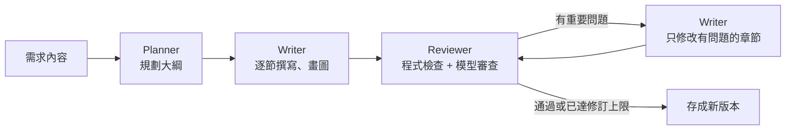

# SAgent 系統分析代理系統

用網頁撰寫、管理系統分析文件（Spec），並讓本機的 AI 模型幫忙寫。

- 前端：網頁（React）
- 後端：Python（FastAPI）
- AI：地端小模型（Ollama），資料不會送出公司

## 三大功能

| 功能 | 內容 |
|---|---|
| 1. Spec 撰寫 | Markdown 編輯器，左邊編輯、右邊即時預覽。支援 Mermaid 圖和 UML 圖（Mermaid 的類別圖、循序圖、狀態圖、使用案例圖，以及選用的 PlantUML） |
| 2. Spec 管理與版本控制 | 專案 → 功能階段 → Spec。每次存檔都是新版本，可以比較差異、還原、加標籤。「基準版本」可以記錄整個專案某個時間點的版本組合，之後比較或匯出 |
| 3. AI 撰寫代理 | 每次執行由三個 agent 合作：Planner 規劃大綱 → Writer 逐節撰寫並畫圖 → Reviewer 審查，有問題再交回 Writer 修訂 |

## 需要先安裝

| 軟體 | 用途 | 備註 |
|---|---|---|
| Python 3.11 以上 + [uv](https://docs.astral.sh/uv/) | 後端 | |
| Node.js 20 以上 | 打包前端 | 只有第一次打包和開發時需要 |
| [Ollama](https://ollama.com/) + 模型 | AI 撰寫 | 例如 `ollama pull qwen3:8b` |

## 快速開始

在專案根目錄執行：

```powershell
.\scripts\start.ps1
```

第一次會自動安裝套件並打包前端。完成後打開 <http://127.0.0.1:8765>。

也可以手動執行：

```powershell
cd frontend
npm install
npm run build
cd ..
uv run --project backend sagent serve
```

### 示範模式（不接模型）

想先看畫面和流程，可以用假模型。AI 撰寫幾秒就完成，內容是固定的示範文字：

```powershell
.\scripts\start.ps1 --fake-llm --data-dir data-demo
```

`--data-dir` 讓示範資料跟正式資料分開。

`data-demo/` 的示範資料是用 `scripts/seed_demo.py` 產生的：一個完整的「設備報修系統」專案，四種類型、九種文件類型都有，AI 撰寫的部分是真的地端模型（qwen3.6:35b-a3b）寫的。也包含構想轉功能規格、AI 修訂、手動編輯、版本標籤、還原、封存、兩個基準版本。要重新產生：

```powershell
uv run --project backend python scripts/seed_demo.py --data-dir data-demo-build
```

在 CPU 上大約要 7～8 小時。中途停掉再跑一次，會從沒做完的地方繼續。產生完確認沒問題，再把 `data-demo-build` 改名成 `data-demo`。加 `--fake` 可以用假模型幾十秒跑完，只檢查流程。

## 使用流程

1. 建立專案。預設有「需求分析」「系統設計」「詳細設計」三個階段，可以改名、增減、調整順序。
2. 新增 Spec：先選類型（Concept、Functionality、Technical、Change），再選這個類型的文件類型。內容來源可以選：
   - 用 AI 撰寫：貼上需求，直接開始
   - 範本骨架：依文件類型產生空白章節
   - 空白文件、匯入 Markdown
3. 構想確定要做時，在構想文件上按「轉成功能規格」，會用構想的內容當需求，另外建立一份功能規格。兩份文件會互相連結。
4. 編輯後按「儲存新版本」（Ctrl+S）。每次存檔都會留下一個版本。
5. 右側「AI 代理」：
   - 撰寫整份文件：依需求從頭寫
   - 依需求修訂：只修改跟需求有關的章節，其他章節不動
6. 右側「版本」：檢視、比較、還原、加標籤、下載任何一個版本。
7. 文件告一段落（例如送客戶確認）時，到「基準版本」建立一個基準。之後可以看哪些文件改過，或匯出當時的全部文件。

### 快捷鍵

| 按鍵 | 做什麼 |
|---|---|
| Ctrl+S | 儲存新版本 |
| Ctrl+K | 快速切換到同一個專案的其他 Spec 或頁面 |
| Ctrl+Enter | 在 AI 需求欄裡按，開始 AI 撰寫 |
| Esc | 關閉對話框或選單 |

右上角的圖示可以切換顏色：跟著系統、淺色、深色。

## 類型與文件類型（範本）

新增 Spec 時先選「類型」，也就是這件事想得多清楚了，再選文件類型。不同文件類型的章節和寫法不一樣。

| 類型 | 適合的狀況 | 文件類型 |
|---|---|---|
| Concept | 只有想法，還沒確定要不要做 | 構想提案 |
| Functionality | 已經確定要做這個功能 | 功能規格書、使用案例規格、SDD 功能規格、UI/UX 設計建議 |
| Technical | 已經有功能規格，要設計怎麼實作 | 系統架構設計、資料庫設計、API 規格 |
| Change | 要修改既有系統的功能 | 變更需求說明 |

| 文件類型 | 主要章節 |
|---|---|
| 構想提案 | 背景與問題、目標使用者與情境、構想說明、可能的做法、預期效益、假設與風險、下一步 |
| 功能規格書 | 目的與範圍、角色與使用案例、功能需求、業務流程、資料需求、業務規則、非功能需求、驗收條件 |
| 使用案例規格 | 角色、使用案例總覽、使用案例說明、狀態變化 |
| SDD 功能規格（五節體例） | Requirement、Decision、Constraint、Rule、Verification |
| UI/UX 設計建議 | 使用者與使用情境、重點建議、畫面規劃、操作流程、版面與資訊呈現、表單與輸入、提示訊息與錯誤處理、無障礙與裝置支援、驗證方式 |
| 系統架構設計 | 設計目標、元件設計、主要流程、部署架構、技術選型、安全設計、設計決策 |
| 資料庫設計 | 資料模型、資料表定義、索引、資料生命週期 |
| API 規格 | 驗證授權、端點清單、端點說明、呼叫流程、錯誤碼 |
| 變更需求說明 | 變更原因、現況、變更內容、影響範圍、相容性與資料轉換、測試範圍、上線與回復 |

### 構想提案

把還在構想階段的想法整理清楚。需求欄寫幾句話也可以。

- 不寫細節規格：沒有欄位、API、FR 編號需求。最多畫一張流程圖，章節也比較少，所以跑得比功能規格書快。
- 只有「可能的做法」這一節可以提出需求沒寫的做法，會列 2～3 種做法比較優缺點。其他章節只整理需求裡有的內容，不清楚的地方標「待確認」。
- 確定要做時，按文件上方的「轉成功能規格」：開新增 Spec 對話框，類型選好 Functionality，需求欄帶入構想文件目前的內容。新的 Spec 會記錄來源，兩份文件上方都會顯示連結。

### UI/UX 設計建議

依需求提出畫面和操作上的建議，不畫圖。

- 用法：新增 Spec 時文件類型選「UI/UX 設計建議」，需求欄貼上需求內容，或已經寫好的功能規格。
- 「重點建議」一節會列出編號 UX-01、UX-02… 的建議，每條都有理由和優先順序（高、中、低）。後面的章節會引用這些編號。
- 跟其他文件類型不同，AI 可以提出需求沒有寫的做法，但需求沒提到的事實（數字、既有系統、使用者人數）不能編造。審查也照這個標準：建議要具體、要有理由。

### 自訂範本

可以自己加範本：在 `data/templates/` 放 YAML 檔，格式照 `backend/sagent/doc_templates/` 裡的檔案。key 相同時會取代內建範本，不用重新啟動。

範本的選用欄位：

| 欄位 | 預設值 | 說明 |
|---|---|---|
| `category` | `feature` | 類型：`idea` Concept、`feature` Functionality、`design` Technical、`change` Change |
| `role` | 系統分析師 | 撰寫這種文件的角色，會放進提示詞 |
| `style` | `spec` | 寫作和審查規則：`spec` 規格文件、`advice` 建議類文件（可以提出需求沒寫的做法）、`idea` 構想文件（不寫細節規格） |
| `advice` | `false` | 舊寫法，`true` 等於 `style: advice` |
| `allow_diagrams` | `true` | `false` 表示這種文件不畫圖，AI 撰寫的圖表選項也不會出現 |
| `max_diagrams` | 不限制 | 這種文件最多畫幾張圖。畫面上設定的數量比較多時，以這裡為準 |

## AI 代理怎麼運作



| Agent | 做什麼 | 輸出 |
|---|---|---|
| Planner | 參考文件範本，依需求決定章節、每節要點、要畫哪些圖、哪些地方要跟客戶確認 | JSON 大綱 |
| Writer | 一節一節寫，再一張一張畫圖。圖表語法有錯會自動修正，修不好就請模型重畫一次 | Markdown |
| Reviewer | 先用程式檢查空白章節和圖表語法，再請模型對照需求找出漏掉、矛盾、編造的內容 | 分數和問題清單 |

執行過程會即時顯示在畫面上：目前在哪一步、模型正在輸出的文字、大綱、審查結果。可以離開頁面，完成後會自動存成新版本。每次執行的完整過程都會保留，可以在「AI 工作紀錄」回頭看。

更多細節見 [docs/architecture.md](docs/architecture.md)。

## 速度（CPU 推論）

AI 工作在 CPU 上很慢，一次只會執行一個，其他排隊。

實測環境：Intel i7-1260P、32GB RAM、沒有獨立 GPU。需求內容是一段 8 點的請假系統需求。

| 模型 | 讀提示詞 | 生成 | 一份完整功能規格書 |
|---|---|---|---|
| qwen3:8b | 約 18 tokens/秒 | 約 5.5 tokens/秒 | 72 分鐘（10 節、4 張圖、修訂 1 輪） |
| qwen3.6:35b-a3b（MoE） | 約 30 tokens/秒 | 約 10 tokens/秒 | 32 分鐘（7 節、2 張圖、修訂 1 輪） |

- qwen3:8b 那次是加速調整前跑的（第二輪審查還是讀整份文件），現在會再快一些。
- MoE 模型每次只用一小部分參數計算，在 CPU 上反而比 8B 快，內容品質也比較好，但需要約 22GB 記憶體。
- 調整 Ollama 的執行緒數沒有明顯差別。

再加快的方法：

- AI 撰寫的「進階選項」：減少圖的數量、修訂輪數設為 0、不畫圖
- 有 GPU 的機器速度會快很多

## UML 圖與 PlantUML

| 圖 | 預設 |
|---|---|
| 流程圖、循序圖、類別圖、狀態圖、實體關聯圖、甘特圖 | Mermaid，瀏覽器直接畫 |
| 使用案例圖 | Mermaid 12 原生的使用案例圖（`usecase-beta`） |
| 元件圖、部署圖 | Mermaid flowchart |

PlantUML 是選用功能。要啟用，二選一：

1. 自架 PlantUML 伺服器（例如 `docker run -d -p 8080:8080 plantuml/plantuml-server:jetty`），在「設定」填 `http://localhost:8080`
2. 安裝 Java，把 `plantuml.jar` 放在 `tools/plantuml.jar`

啟用後，「自動」模式下使用案例圖、元件圖、部署圖會改用 PlantUML。也可以在設定選「全部用 PlantUML」。沒有啟用時，PlantUML 圖只顯示原始碼。

注意：不要填公開的 PlantUML 伺服器，圖的內容會被送到外部。

## 設定

畫面上的「設定」頁可以改：Ollama 網址、預設模型、溫度、修訂輪數、UML 語法、PlantUML 伺服器。

啟動時也可以用環境變數：

| 環境變數 | 預設值 | 說明 |
|---|---|---|
| `SAGENT_HOST` / `SAGENT_PORT` | `127.0.0.1` / `8765` | 服務位址 |
| `SAGENT_DATA_DIR` | `data/` | 資料目錄（資料庫、自訂範本） |
| `OLLAMA_BASE_URL` | `http://127.0.0.1:11434` | Ollama 網址 |
| `SAGENT_DEFAULT_MODEL` | `qwen3:8b` | 預設模型 |
| `SAGENT_LLM_PROVIDER` | `ollama` | 設成 `fake` 就是示範模式 |
| `SAGENT_PLANTUML_SERVER` | 空白 | PlantUML 伺服器網址 |
| `SAGENT_PLANTUML_JAR` | `tools/plantuml.jar` | plantuml.jar 位置 |
| `SAGENT_ALLOWED_HOSTS` | 本機時只允許 `127.0.0.1`、`localhost` | 允許的主機名稱，用逗號分隔 |

## 安全

- 目前沒有登入功能。預設只在本機（`127.0.0.1`）提供服務，並且只接受 Host 是 `127.0.0.1` 或 `localhost` 的請求（防 DNS rebinding）。
- 要給同事使用時，用 `--host 0.0.0.0` 啟動，並確認只在公司內網開放。可以用 `SAGENT_ALLOWED_HOSTS` 限定允許的主機名稱。
- 修改資料的 API（POST、PUT、PATCH、DELETE）都要帶 `X-SAgent-Client` 標頭，避免其他網站代替你送出操作。自己寫程式呼叫 API 時記得加上，例如 `-H "X-SAgent-Client: script"`。

## 資料與備份

- 所有資料都在 `data/sagent.db`（SQLite）。備份時先停止服務，再複製整個 `data/` 資料夾。
- 「匯出全部（zip）」會產生每份 Spec 的 Markdown 檔、圖表原始檔（`.mmd`、`.puml`）和 `manifest.json`，方便放進 git 或交給其他人。

## 開發

```powershell
# 後端（程式改了自動重新載入）
uv run --project backend sagent serve --reload

# 前端（另開一個視窗，開 http://localhost:5173，/api 會轉給後端）
cd frontend
npm run dev
```

測試：

```powershell
cd backend
uv run pytest            # 後端測試
uv run ruff check sagent tests

cd ..\frontend
npm run typecheck        # 前端型別檢查
```

直接用命令列跑一次 AI 流程（不經過網頁），方便調整提示詞：

```powershell
uv run --project backend python scripts/run_pipeline.py --requirement-file 需求.txt --out 輸出.md --title "請假系統功能規格"
```

`frontend/scripts/mermaid-validate.mjs` 可以用前端同版本的 Mermaid 檢查圖表語法，升級 Mermaid 後可以用它重新產生 `backend/tests/data/mermaid_cases.json`。

## 專案結構

```
SAgent/
  backend/         Python 後端（FastAPI）
    sagent/        程式
    tests/         測試
  frontend/        網頁前端（React + Vite）
  docs/            文件
  scripts/         啟動和工具腳本
  data/            資料（自動建立，不進版控）
```
