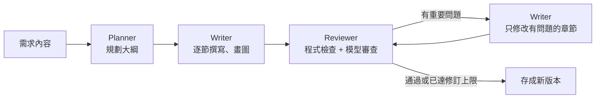

# SAgent 系統分析代理系統

用網頁撰寫、管理系統分析文件（Spec），並讓本機的 AI 模型幫忙寫。

- 前端：網頁（React）
- 後端：Python（FastAPI）
- AI：地端小模型（Ollama），資料不會送出公司

## 三大功能

| 功能 | 內容 |
|---|---|
| 1. Spec 撰寫 | Markdown 編輯器，左邊編輯、右邊即時預覽。支援 Mermaid 圖和 UML 圖（Mermaid 的類別圖、循序圖、狀態圖、使用案例圖，以及選用的 PlantUML） |
| 2. Spec 管理與版本控制 | 專案 → 功能階段 → Spec。每次存檔都是新版本，可以比較差異、還原、加標籤。「基準版本」可以記錄整個專案某個時間點的版本組合，之後比較或匯出 |
| 3. AI 撰寫代理 | 每次執行由三個 agent 合作：Planner 規劃大綱 → Writer 逐節撰寫並畫圖 → Reviewer 審查，有問題再交回 Writer 修訂 |

## 需要先安裝

| 軟體 | 用途 | 備註 |
|---|---|---|
| Python 3.11 以上 + [uv](https://docs.astral.sh/uv/) | 後端 | 沒有 uv 也可以，見下面「不用 uv」 |
| Node.js 20 以上 | 打包前端 | 只有第一次打包和開發時需要 |
| [Ollama](https://ollama.com/) + 模型 | AI 撰寫 | 預設模型 `ollama pull qwen3.6:35b-a3b`（約 22GB 記憶體）；記憶體不到 32GB 用 `qwen3:8b` |

## 快速開始

在專案根目錄執行：

```powershell
.\scripts\start.ps1
```

第一次會自動安裝套件並打包前端。完成後打開 <http://127.0.0.1:8765>。

也可以手動執行：

```powershell
cd frontend
npm install
npm run build
cd ..
uv run --project backend sagent serve
```

### 不用 uv

`start.ps1` 找不到 uv 時，會改用 `backend\.venv` 裡的 Python。還沒有 `.venv` 的話，用 Python 3.11 以上自己建立：

```powershell
python -m venv backend\.venv
backend\.venv\Scripts\python.exe -m pip install -e backend pytest ruff
```

pip 不會讀 `uv.lock`，套件版本可能跟用 uv 安裝的不同。其他指令把 `uv run --project backend python` 換成 `backend\.venv\Scripts\python.exe`；在 `backend` 目錄裡的 `uv run pytest`、`uv run ruff` 換成 `.\.venv\Scripts\pytest.exe`、`.\.venv\Scripts\ruff.exe`。

### 示範模式（不接模型）

想先看畫面和流程，可以用假模型。AI 撰寫幾秒就完成，內容是固定的示範文字：

```powershell
.\scripts\start.ps1 --fake-llm --data-dir data-demo
```

`--data-dir` 讓示範資料跟正式資料分開。

repo 不附示範資料，`data-demo/` 不存在時啟動會建立空的資料庫。可以用 `scripts/seed_demo.py` 產生完整的示範情境：四個專案（設備報修、採購請購簽核、會議室與訪客預約、客服工單與知識庫），每個都從構想走到第二期變更；另外一個 Algorithm 類型的專案「數獨解題與出題引擎」。也包含構想轉功能規格、AI 修訂、手動編輯、版本標籤、還原、封存、基準版本比較、自訂範本，以及失敗和取消的 AI 工作。情境和需求內容在 `scripts/demo_scenarios.py`。

**示範資料的文件內容是模擬的，不是地端模型實際的產出。** 內容由 AI 子代理事先寫好（`scripts/demo_content/`），再由腳本模型（`scripts/demo_llm.py`）依序回答給 SAgent 真正的 AI 流程（Planner → Writer → Reviewer），所以 AI 工作紀錄、步驟、大綱、審查結果、版本都跟實際操作一樣，只是速度和文字品質不代表地端模型。地端模型實際的速度見下面的「速度」一節。要重新產生：

```powershell
uv run --project backend python scripts/check_demo_content.py scripts/demo_content
uv run --project backend python scripts/seed_demo.py --data-dir data-demo-build --script scripts/demo_content
```

第一行檢查內容檔（格式、Mermaid 語法、簡體字，並用腳本模型實際跑一次 AI 流程），第二行大約 2 分鐘。產生完確認沒問題，再把 `data-demo-build` 改名成 `data-demo`。內容檔的格式見 `DEMO_DATA_PLAN.md`。

不加 `--script` 就是用真的地端模型寫，模型和 AI 設定跟 SAgent 目前的設定一樣，在 CPU 上大約要 29～34 小時（約 39 份 AI 文件）。中途停掉再跑一次，會從沒做完的地方繼續；Ollama 連不到時會先等它啟動。加 `--fake` 可以用假模型約 10 分鐘跑完，只檢查流程。

示範時用 `--fake-llm` 啟動，現場按 AI 撰寫會寫進假模型的固定內容，示範前先備份 `data-demo/`。

## 使用流程

1. 建立專案。預設有「需求萃取」「系統分析」「系統設計」三個階段，可以改名、增減、調整順序。首頁可以搜尋、依更新時間或名稱排序、切換卡片和列表；每個專案的階段條一格代表一個階段，有 Spec 的階段會上色，AI 正在撰寫或排隊時會顯示標籤。專案總覽可以編輯「專案詞彙表」：列出角色、狀態、主要資料的名稱，AI 撰寫每一份文件時都會照這些名稱寫；AI 工作完成後也會提議把新的名詞加進去。
2. 新增 Spec：先選類型（Concept、Functionality、Technical、Algorithm、Change），再選這個類型的文件類型。內容來源可以選：
   - 用 AI 撰寫：貼上需求就開始。「先確認大綱再撰寫」預設勾選，規劃完會先停下來讓你確認（見第 5 步）
   - 範本骨架：依文件類型產生空白章節
   - 空白文件、匯入 Markdown
3. 構想確定要做時，在構想文件上按「轉成功能規格」，會用構想的內容當需求，另外建立一份功能規格。兩份文件會互相連結。
4. 編輯後按「儲存新版本」（Ctrl+S）。每次存檔都會留下一個版本。螢幕不到 1440 寬時，Spec 頁的左側欄預設收成一排圖示，讓編輯區和預覽區寬一點；按放大鏡圖示或 Ctrl+K 切換到其他 Spec。左側欄展開或收合會記住，Spec 頁和其他頁面分開記。
5. 右側「AI 撰寫」（文件類型建立後不能改，AI 一律照這份 Spec 的文件類型撰寫）：
   - 撰寫整份文件：依需求從頭寫。「先確認大綱再撰寫」預設勾選，Planner 規劃完（約 3～5 分鐘）會先停下來，讓你回答待確認問題、調整名詞表和各節要點，按「繼續撰寫」才開始寫。回答過的問題會寫進文件的「待確認事項」，標成已確認
   - 依需求修訂：只修改跟需求有關的章節，其他章節不動
6. 右側「審查」：最近一次 AI 工作的審查列出的格式、邏輯錯誤和需要人工覆核的地方。點章節名稱跳到文件對應的位置，改好或確認過的項目打勾標成已處理（記在伺服器，換瀏覽器也看得到）。還有沒處理的項目時，標題旁會顯示「待處理 N」，左側清單和專案總覽也會顯示數量。新的 AI 工作完成後改看新的審查結果。
7. 右側「版本」：檢視、比較、還原、加標籤、下載任何一個版本。
8. 文件告一段落（例如送客戶確認）時，到「基準版本」建立一個基準。之後可以看哪些文件改過，或匯出當時的全部文件。

### 快捷鍵

| 按鍵 | 做什麼 |
|---|---|
| Ctrl+S | 儲存新版本 |
| Ctrl+K | 快速切換到同一個專案的其他 Spec 或頁面 |
| Ctrl+Enter | 在 AI 需求欄裡按，開始 AI 撰寫 |
| Esc | 關閉對話框或選單 |
| ↑ ↓、Home、End | 在選單裡移動；在選單按鈕上按 ↓ 直接打開選單 |

右上角的圖示可以切換顏色：跟著系統、淺色、深色。

有 AI 工作在撰寫、排隊或等待確認大綱時，頂端列會顯示是哪一份文件（點開可以看全部進行中的工作，點一項跳到那份 Spec），專案總覽的「狀態」欄也會標出來，瀏覽器分頁標題前面會加「● AI 撰寫中」或「● 待確認大綱」。工作完成、失敗或大綱完成時，不管在哪一頁都會跳提示；分頁在背景時，分頁標題會留著結果直到你回來。在頂端列的選單裡可以開啟桌面通知。

## 類型與文件類型（範本）

新增 Spec 時先選「類型」，也就是這件事想得多清楚了，再選文件類型。不同文件類型的章節和寫法不一樣。

| 類型 | 適合的狀況 | 文件類型 |
|---|---|---|
| Concept | 只有想法，還沒確定要不要做 | 構想提案 |
| Functionality | 已經確定要做這個功能，要解決具體的問題 | 功能規格書、使用案例規格、SDD 功能規格、UI/UX 設計建議、測試計畫 |
| Technical | 要決定怎麼實作：先比較幾個做法，再寫細節設計 | 技術決策、系統架構設計、資料庫設計、API 規格、實驗設計 |
| Algorithm | 要設計演算法 | 演算法設計 |
| Change | 要修改既有系統，或記錄已經改了什麼 | 變更需求說明、變更紀錄 |

「固定」表示章節固定（見下面的「固定章節和編號」），括號裡是這一節的編號。用 `seed_demo.py` 產生的示範資料會另外放一份自訂的「測試計畫」範本（key 跟內建的一樣），會蓋過內建版本。

| 文件類型 | 固定 | 章節 |
|---|---|---|
| 構想提案 | ✓ | 背景與問題、目標使用者與情境、構想說明、使用者故事（US）、驗收條件（AC）、可能的做法、假設與風險、下一步 |
| 功能規格書 | | 目的與範圍、名詞定義、角色與使用案例、功能需求（FR）、業務流程、系統互動、資料需求、業務規則（BR）、非功能需求（NFR）、驗收條件（AC） |
| 使用案例規格 | ✓ | 概述、角色、使用案例總覽（UC）、使用案例說明、狀態變化、業務規則（BR）、驗證方式（AC） |
| SDD 功能規格（五節體例） | ✓ | Requirement（R）、Decision（D）、Constraint（C）、Rule（RL）、Verification（V） |
| UI/UX 設計建議 | | 使用者與使用情境、重點建議（UX）、畫面規劃、操作流程、版面與資訊呈現、表單與輸入、提示訊息與錯誤處理、無障礙與裝置支援、驗證方式 |
| 測試計畫 | | 測試範圍、測試環境與資料、測試案例（TC）、通過標準、時程與分工 |
| 技術決策 | ✓ | 背景與問題、限制與評估標準（C）、方案說明、方案比較、建議方案、影響與後續 |
| 系統架構設計 | | 設計目標與限制、系統環境、元件設計、主要流程、部署架構、技術選型與決策、安全設計 |
| 資料庫設計 | | 設計說明、資料模型、資料表定義、索引與限制、資料生命週期、資料移轉與備份 |
| API 規格 | | 概述、驗證與授權、端點清單（API）、端點說明、呼叫流程、錯誤碼、限制與注意事項 |
| 實驗設計 | | 實驗目的、研究假設（H）、指標定義（M）、實驗對象與分組、實驗流程、資料收集與分析方法、風險與限制 |
| 演算法設計 | | 問題定義、資料表示、解題方法、虛擬碼、複雜度分析、邊界情況與錯誤處理、測試案例（TC） |
| 變更需求說明 | | 變更原因、現況、變更內容（CR）、影響範圍、相容性與資料轉換、測試範圍（AC）、上線與回復 |
| 變更紀錄 | ✓ | 變更摘要、變更原因、差異對照（CH）、影響範圍、後續事項 |

Functionality 的三份規格怎麼選：

- 功能規格書：最完整，10 節、4 張圖，CPU 上跑最久。
- 使用案例規格：重點放在角色和系統的互動，流程分支多時用。
- SDD 功能規格：條目都有編號、可以互相對照，要交給 AI coding 工具實作時用。

系統架構設計的「技術選型與決策」只列已經決定的結果和依據，不重新比較方案；要比較方案時先寫「技術決策」。

### 固定章節和編號

- 範本設 `fixed_sections: true` 時章節固定：AI 撰寫時章節名稱、順序和每節的目標都照範本，Planner 只決定每節的要點和圖，不會刪章節、加章節或改名。修訂時也不會刪掉範本裡的章節。不固定的範本，Planner 可以依需求刪減或新增章節。
- 哪一節要編號寫在範本章節的 `ids`，例如 `ids: FR` 表示這一節的項目編 FR-01、FR-02…。沒有 `ids` 的章節不新增編號，只引用其他章節的編號。審查時程式會檢查有 `ids` 的章節是不是真的有編號，沒有就交給 Writer 修正。

### 構想提案

把還在構想階段的想法整理清楚。需求欄寫幾句話也可以。

- 不寫細節規格：沒有欄位、API、FR 編號需求。最多畫一張流程圖，章節也比較少，所以跑得比功能規格書快。
- 使用者故事寫成「身為〈角色〉，我想要〈做什麼〉，以便〈得到什麼〉」，編號 US-01、US-02…。驗收條件編號 AC-01…，只寫「怎樣算成功」（使用者看得到的結果），不寫欄位、錯誤碼和畫面細節。
- 只有「可能的做法」這一節可以提出需求沒寫的做法，會列 2～3 種做法比較優缺點。其他章節只整理需求裡有的內容，不清楚的地方標「待確認」。
- 確定要做時，按文件上方的「轉成功能規格」：開新增 Spec 對話框，類型選好 Functionality，需求欄帶入構想文件目前的內容。新的 Spec 會記錄來源，兩份文件上方都會顯示連結。構想裡的使用者故事可以寫成使用案例，驗收條件可以寫成驗證方式。

### 技術決策

比較幾個技術方案，選出一個，例如「搜尋用資料庫全文檢索還是另外架搜尋引擎」「報表用現成工具還是自己做」。

- 用法：新增 Spec 時類型選 Technical，文件類型選「技術決策」。需求欄寫清楚要做什麼決定、有哪些限制、用什麼標準比較；已經想到的方案也可以列出來。
- 要做的決定、限制和評估標準照需求寫，需求沒寫的標「假設」或「待確認」。方案可以由 AI 提出，需求列出的方案一定會放進比較。限制和評估標準編號 C-01、C-02…，比較表的每一列引用這些編號。
- 比較用「較好、普通、較差」加理由，不編造效能、成本、時間的數字；要實測才能判斷的地方標「待確認」，並寫要怎麼驗證。需要數據才能決定時，可以再開一份實驗設計。
- 只有「建議方案」畫圖（元件圖），最多兩張。選定之後，再寫系統架構設計、資料庫設計、API 規格。
- 審查時，AI 提出的方案不算編造；比較結果和優缺點對不上、建議的理由和比較結果矛盾、寫出沒有根據的數字算錯誤；需求沒提到的限制或評估標準會列進人工覆核。

### UI/UX 設計建議

依需求提出畫面和操作上的建議，不畫圖。

- 用法：新增 Spec 時文件類型選「UI/UX 設計建議」，需求欄貼上需求內容，或已經寫好的功能規格。
- 「重點建議」一節會列出編號 UX-01、UX-02… 的建議，每條都有理由和優先順序（高、中、低）。後面的章節會引用這些編號。
- 跟其他文件類型不同，AI 可以提出需求沒有寫的做法，但需求沒提到的事實（數字、既有系統、使用者人數）不能編造。審查時，超出需求的建議不算錯誤；建議裡用到需求沒提到的事實，會列進人工覆核。

### 演算法設計

設計解決特定問題的演算法，例如數獨的解題和出題、排程、路徑規劃。

- 用法：新增 Spec 時類型選 Algorithm，文件類型選「演算法設計」。需求欄寫清楚要解決的問題、輸入和輸出、限制條件和效能要求。例如：「解 9×9 數獨，題目用 81 個字元表示，0 是空格；沒有解或有多個解時要回報；手機上每題要在 1 秒內解完。」
- 輸入、輸出、限制條件和效能數字照需求寫，需求沒寫的標「假設」或「待確認」。解法、資料結構和虛擬碼由 AI 設計：先說明採用哪一種設計策略（暴力法、分治法、貪婪法、動態規劃、回溯法、圖形搜尋等）和理由，再寫步驟；有多種做法時會比較並說明選用的理由。
- 虛擬碼放在 ` ```text ` 程式碼區塊；複雜度用大 O 表示。測試案例編號 TC-01、TC-02…。最多畫兩張圖（通常是解題流程圖）。
- 審查時，AI 設計的解法不算編造；文字說明、虛擬碼、複雜度和測試案例的預期結果互相矛盾算錯誤；需求沒提到的限制或效能數字會列進人工覆核。

### 實驗設計

設計評估新工具或新做法的實驗，例如試用 AI 程式碼審查工具、比較兩種測試流程、新介面的 A/B 測試。

- 用法：新增 Spec 時類型選 Technical，文件類型選「實驗設計」。需求欄寫清楚要評估什麼、想知道的事、可以參與的人和時間、怎樣算成功。例如：「評估 AI 程式碼審查工具，三個團隊參加 8 週；PR 前置時間縮短 20% 以上、誤報比例不超過 40% 才導入。」
- 評估對象、人數、期間和判斷標準照需求寫，需求沒寫的標「假設」或「待確認」。研究假設、指標、分組方式、實驗步驟和統計方法由 AI 設計，並說明理由。
- 研究假設編號 H-01、H-02…，指標編號 M-01、M-02…。每個假設都寫比較的對象、用哪個指標判斷、怎樣算成立。最多畫兩張圖（通常是實驗流程圖）。
- 實驗還沒做，文件不會寫實驗結果。審查時，AI 設計的實驗方法不算編造；假設用到沒定義的指標、分析方法不適合資料型態、人數或期間前後不一致算錯誤；需求沒提到的人數、期間或判斷標準會列進人工覆核。

### 自訂範本

可以自己加範本：在 `data/templates/` 放 YAML 檔，格式照 `backend/sagent/doc_templates/` 裡的檔案。key 相同時會取代內建範本，不用重新啟動。

範本的選用欄位：

| 欄位 | 預設值 | 說明 |
|---|---|---|
| `category` | `feature` | 類型：`idea` Concept、`feature` Functionality、`design` Technical、`algorithm` Algorithm、`change` Change |
| `role` | 系統分析師 | 撰寫這種文件的角色，會放進提示詞 |
| `style` | `spec` | 寫作和審查規則：`spec` 規格文件、`advice` 建議類文件（可以提出需求沒寫的做法）、`idea` 構想文件（不寫細節規格）、`decision` 技術決策文件（方案可以由 AI 提出，不編造數字）、`algorithm` 演算法設計文件（解法由 AI 設計）、`experiment` 實驗設計文件（實驗方法由 AI 設計） |
| `advice` | `false` | 舊寫法，`true` 等於 `style: advice` |
| `allow_diagrams` | `true` | `false` 表示這種文件不畫圖，AI 撰寫的圖表選項也不會出現 |
| `max_diagrams` | 不限制 | 這種文件最多畫幾張圖。畫面上設定的數量比較多時，以這裡為準 |
| `fixed_sections` | `false` | `true` 表示章節固定，AI 撰寫時不刪、不加、不改名，也不受章節數量上限（10 節）的限制 |

每個章節可以寫：

| 欄位 | 說明 |
|---|---|
| `heading` | 章節名稱（必填） |
| `goal` | 這一節要寫什麼，寫清楚格式（例如表格的欄位） |
| `diagrams` | 建議的圖，例如 `[flowchart]` |
| `ids` | 這一節的項目用什麼編號，例如 `FR`（1～4 個大寫英文字母）。舊範本把「編號 FR-01、FR-02…」寫在 `goal` 裡也可以，系統會自動找出來 |

## AI 代理怎麼運作



| Agent | 做什麼 | 輸出 |
|---|---|---|
| Planner | 參考文件範本，依需求決定章節、每節要點、要畫哪些圖、哪些地方要跟客戶確認，並列出名詞表（角色、狀態、主要資料的名稱，每一節都照這份用） | JSON 大綱 |
| Writer | 一節一節寫，再一張一張畫圖。圖表語法有錯會自動修正，修不好就請模型重畫一次 | Markdown |
| Reviewer | 只找格式和邏輯上的錯誤，以及需要人工覆核的地方。格式問題（表格欄數、引用沒定義的編號、圖表語法）由程式檢查；邏輯問題（前後矛盾、跟需求矛盾）由模型找 | 錯誤清單（交給 Writer 修正）、人工覆核清單（列給使用者確認） |

執行過程會即時顯示在畫面上：目前在哪一步、模型正在輸出的文字、大綱、審查結果。審查結果分兩塊：「格式、邏輯錯誤」會自動交給 Writer 修正；「需要人工覆核」列出文件標註（假設）、（待確認）的地方，需求沒提到、文件卻寫得很具體的內容，以及需求有、文件裡卻找不到的數字或句子，請使用者自己確認。審查不打分數。可以離開頁面，完成後會自動存成新版本。每次執行的完整過程都會保留，可以在「AI 工作紀錄」回頭看。

更多細節見 [docs/architecture.md](docs/architecture.md)。

## 速度（CPU 推論）

AI 工作在 CPU 上很慢，一次只會執行一個，其他排隊。

實測環境：Intel i7-1260P、32GB RAM、沒有獨立 GPU。需求內容是一段 8 點的請假系統需求。

| 模型 | 讀提示詞 | 生成 | 一份完整功能規格書 |
|---|---|---|---|
| qwen3:8b | 約 18 tokens/秒 | 約 5.5 tokens/秒 | 72 分鐘（10 節、4 張圖、修訂 1 輪） |
| qwen3.6:35b-a3b（MoE） | 約 30 tokens/秒 | 約 10 tokens/秒 | 32 分鐘（7 節、2 張圖、修訂 1 輪） |

- qwen3:8b 那次是加速調整前跑的（第二輪審查還是讀整份文件），現在會再快一些。
- MoE 模型每次只用一小部分參數計算，在 CPU 上反而比 8B 快，內容品質也比較好，所以預設模型是 qwen3.6:35b-a3b，但需要約 22GB 記憶體。記憶體不到 32GB 的機器，在「設定」把預設模型改成 qwen3:8b（速度和品質都比較差）。
- 調整 Ollama 的執行緒數沒有明顯差別。
- AI 工作結束後的「用量」表會分開列出讀提示詞和生成的時間。

再加快的方法：

- 「設定」頁：修訂輪數設為 0、不畫圖（AI 撰寫面板不另外選，每次都用設定頁的值）
- 有 GPU 的機器速度會快很多

## UML 圖與 PlantUML

| 圖 | 預設 |
|---|---|
| 流程圖、循序圖、類別圖、狀態圖、實體關聯圖、甘特圖 | Mermaid，瀏覽器直接畫 |
| 使用案例圖 | Mermaid 12 原生的使用案例圖（`usecase-beta`） |
| 元件圖、部署圖 | Mermaid flowchart |

編輯器的「插入圖表」選單：

- 除了上面這些，還有泳道流程圖、心智圖、象限圖、使用者旅程圖、時間軸。這幾種只能手動插入，AI 撰寫不會畫。
- 依用途分組，每種圖有一行說明。最上面列出這份文件的範本常用的圖。
- 插入的是精簡骨架，文字是佔位字，語法提示寫在註解裡（註解不會畫出來）。插入後圖名會被選取，直接打字就能改名。
- 啟用 PlantUML 時，選單頂端可以切換 Mermaid 或 PlantUML。PlantUML 沒有的圖（象限圖、使用者旅程圖、時間軸）切到 PlantUML 時不列出。

PlantUML 是選用功能。要啟用，二選一：

1. 自架 PlantUML 伺服器（例如 `docker run -d -p 8080:8080 plantuml/plantuml-server:jetty`），啟動時用環境變數 `SAGENT_PLANTUML_SERVER=http://localhost:8080` 指定
2. 安裝 Java，把 `plantuml.jar` 放在 `tools/plantuml.jar`

啟用後，「自動」模式下使用案例圖、元件圖、部署圖會改用 PlantUML。也可以在設定選「全部用 PlantUML」。沒有啟用時，PlantUML 圖只顯示原始碼。

注意：不要填公開的 PlantUML 伺服器，圖的內容會被送到外部。

## 設定

畫面上的「設定」頁可以改：Ollama 網址、預設模型、溫度、Context 長度、修訂輪數、畫圖、UML 語法。AI 撰寫一律用這裡的值，面板上不另外選。每份文件最多畫 4 張圖，範本設了 `max_diagrams` 時照範本。PlantUML 伺服器用環境變數設定。

Context 長度設 0 時由 Ollama 決定：有設環境變數 `OLLAMA_CONTEXT_LENGTH` 就用它，沒有的話依顯示卡記憶體，沒有 GPU 只有 4096，審查時很容易不夠。設定頁會顯示模型目前實際的值；AI 工作中輸入加上輸出上限超過這個值時，工作紀錄會出現警告。建議設成 16384 以上。

啟動時也可以用環境變數：

| 環境變數 | 預設值 | 說明 |
|---|---|---|
| `SAGENT_HOST` / `SAGENT_PORT` | `127.0.0.1` / `8765` | 服務位址 |
| `SAGENT_DATA_DIR` | `data/` | 資料目錄（資料庫、自訂範本） |
| `OLLAMA_BASE_URL` | `http://127.0.0.1:11434` | Ollama 網址 |
| `SAGENT_DEFAULT_MODEL` | `qwen3.6:35b-a3b` | 預設模型 |
| `SAGENT_LLM_PROVIDER` | `ollama` | 設成 `fake` 就是示範模式 |
| `SAGENT_PLANTUML_SERVER` | 空白 | PlantUML 伺服器網址 |
| `SAGENT_PLANTUML_JAR` | `tools/plantuml.jar` | plantuml.jar 位置 |
| `SAGENT_ALLOWED_HOSTS` | 本機時只允許 `127.0.0.1`、`localhost` | 允許的主機名稱，用逗號分隔 |

## 安全

- 目前沒有登入功能。預設只在本機（`127.0.0.1`）提供服務，並且只接受 Host 是 `127.0.0.1` 或 `localhost` 的請求（防 DNS rebinding）。
- 要給同事使用時，用 `--host 0.0.0.0` 啟動，並確認只在公司內網開放。可以用 `SAGENT_ALLOWED_HOSTS` 限定允許的主機名稱。
- 修改資料的 API（POST、PUT、PATCH、DELETE）都要帶 `X-SAgent-Client` 標頭，避免其他網站代替你送出操作。自己寫程式呼叫 API 時記得加上，例如 `-H "X-SAgent-Client: script"`。

## 資料與備份

- 所有資料都在 `data/sagent.db`（SQLite）。備份時先停止服務，再複製整個 `data/` 資料夾。
- 「匯出全部（zip）」會產生每份 Spec 的 Markdown 檔、圖表原始檔（`.mmd`、`.puml`）和 `manifest.json`，方便放進 git 或交給其他人。

## 開發

```powershell
# 後端（程式改了自動重新載入）
uv run --project backend sagent serve --reload

# 前端（另開一個視窗，開 http://localhost:5173，/api 會轉給後端）
cd frontend
npm run dev
```

測試：

```powershell
cd backend
uv run pytest            # 後端測試
uv run ruff check sagent tests

cd ..\frontend
npm run typecheck        # 前端型別檢查
```

直接用命令列跑一次 AI 流程（不經過網頁），方便調整提示詞：

```powershell
uv run --project backend python scripts/run_pipeline.py --requirement-file 需求.txt --out 輸出.md --title "請假系統功能規格"
```

`frontend/scripts/mermaid-validate.mjs` 可以用前端同版本的 Mermaid 檢查圖表語法，升級 Mermaid 後可以用它重新產生 `backend/tests/data/mermaid_cases.json`。

## 專案結構

```
SAgent/
  backend/         Python 後端（FastAPI）
    sagent/        程式
    tests/         測試
  frontend/        網頁前端（React + Vite）
  docs/            文件
  scripts/         啟動和工具腳本
  data/            資料（自動建立，不進版控）
```
