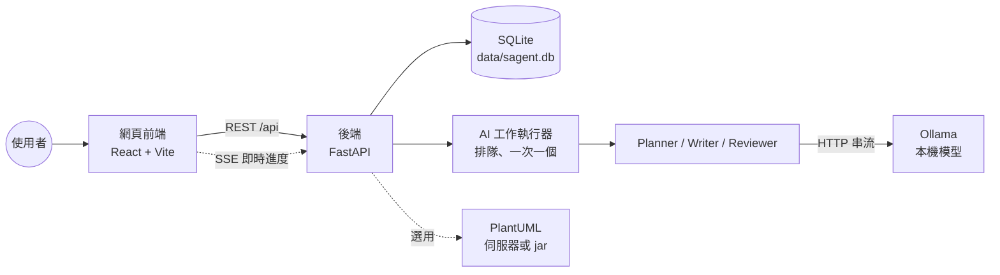
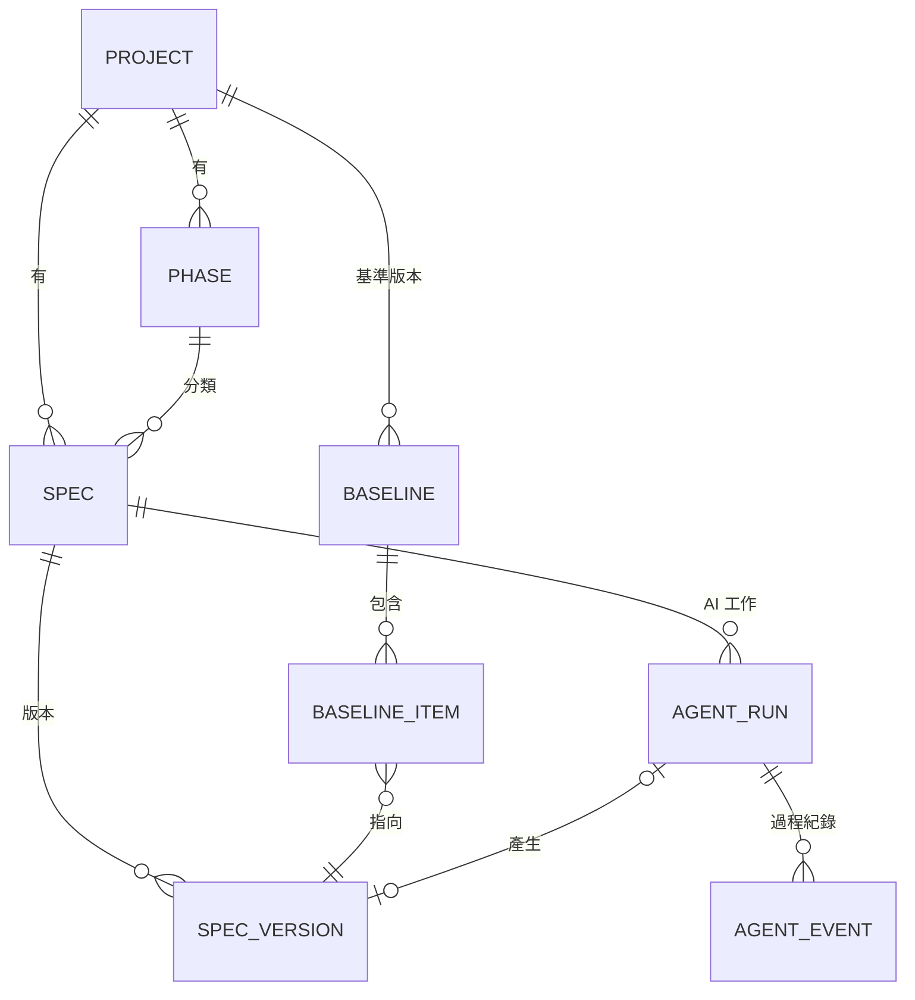
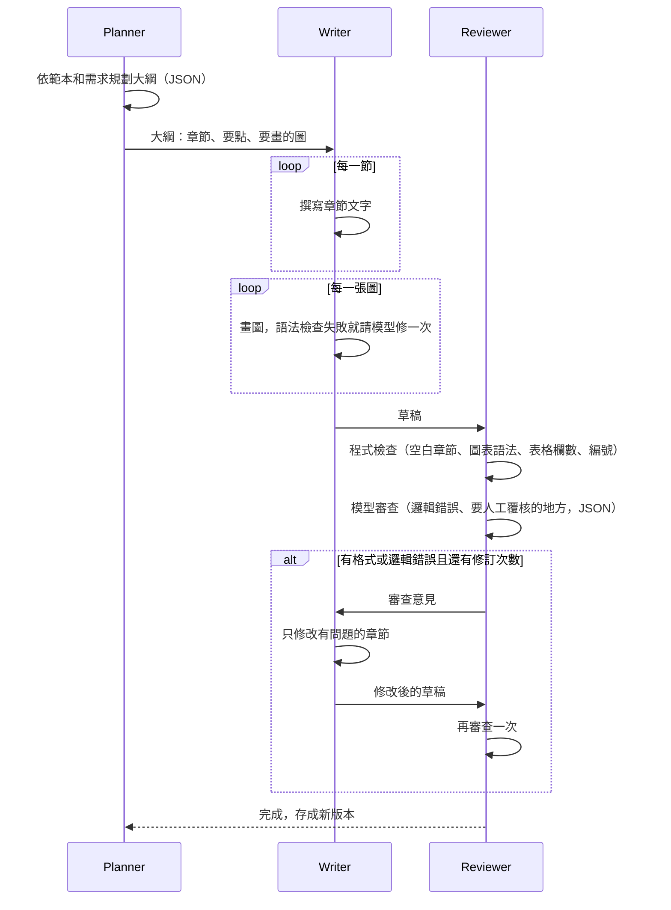

# SAgent 架構說明

這份文件說明 SAgent 怎麼組成、資料怎麼存、AI 代理怎麼運作，以及幾個重要的設計決定。

## 1. 整體架構



| 元件 | 技術 | 職責 |
|---|---|---|
| 網頁前端 | React 19、Vite 8、TanStack Query、CodeMirror、Mermaid 12 | 編輯、預覽、版本、AI 面板 |
| 後端 API | Python、FastAPI、SQLAlchemy | 專案、Spec、版本、基準版本、匯出 |
| AI 工作執行器 | asyncio 背景工作 | 排隊執行 AI 工作、推送進度 |
| AI 代理 | 自己實作（沒有用 LangChain 等框架） | 規劃、撰寫、審查 |
| 模型 | Ollama（預設 qwen3.6:35b-a3b） | 地端推論，資料不出公司 |
| 資料庫 | SQLite（WAL 模式） | 單一檔案，好備份 |

前端打包後是靜態檔，由後端直接提供。執行時不需要 Node.js。

## 2. 資料模型



| 資料表 | 說明 |
|---|---|
| projects | 專案，含專案詞彙表 `glossary`（`[{name, kind, note}]`，最多 40 個）。可以從 Spec 抽出名詞加進來（`services/glossary.py`）：程式抽名詞定義表、角色表、狀態表、實體表（英文代號改用說明開頭的中文名稱）、Mermaid 狀態圖，以及內文「狀態為「已提交」」這類寫法，不呼叫模型。跟詞彙表比對後分成新的名詞（預設勾選）和說法不一樣的（預設不勾，文件沒寫明種類時保留詞彙表原本的種類），使用者勾選後才更新。從文件自動寫進詞彙表會讓一份寫錯的文件影響之後所有的文件，所以一定要人確認。詞彙表用文字框編輯，所以不另外記每個名詞的來源 |
| phases | 功能階段，名稱自訂（例如「需求萃取」「第二期」），可排序 |
| specs | Spec 文件，記錄目前最新版本號 `head_version_no`、狀態、是否封存，以及從哪一份 Spec 轉過來的 `source_spec_id`（例如構想 → 功能規格） |
| spec_versions | 每個版本的完整內容，以及跟前一版比較新增、刪除幾行。建立後不再修改，只有「標籤」可以改 |
| baselines / baseline_items | 基準版本：某個時間點每份 Spec 用的是哪一版 |
| agent_runs | AI 工作：需求、選項、大綱、審查結果、用量、結果版本；`review_checked` 記使用者標成已處理的審查項目，`review_labels` 記怎麼處理的（`fixed` 已處理、`false` 誤報、`skip` 略過）；`checkpoint` 是執行中的檢查點（見 4.5 節），工作結束就清掉（超過時間上限時保留）。`stop_reason` 是為什麼停下來、`wall_seconds` 是實際經過的秒數（見 4.5 節）。選項裡的 `prompt_version` 記這次用的提示詞、範本、程式版本，`environment` 記 Ollama 版本和模型 digest |
| agent_events | AI 工作的步驟紀錄（開始、結束、警告），可重播 |
| settings | 畫面上可調整的設定 |

資料庫升級：新的資料表啟動時自動建立；舊資料表要加欄位時，寫在 `backend/sagent/migrations.py`，啟動時自動執行，已經升級過就不會重做。

## 3. 版本控制

規則很簡單：

1. 每次存檔都產生新版本（v1、v2、v3…），舊版本永遠保留。
2. 內容沒變就不產生新版本。
3. 存檔時會帶「我是根據第幾版改的」。如果別人（或 AI）已經存了更新的版本，會回 409，畫面提示使用者比較差異後再決定。
4. 還原 = 把舊版內容存成新版本，不會刪掉任何版本。
5. 版本可以加標籤（例如「客戶確認版」）。
6. 基準版本記錄整個專案（或某個階段）當下的版本組合，之後可以：
   - 跟目前最新版比較：哪些 Spec 有變更、新增、移除
   - 兩個基準版本互相比較
   - 匯出當時的所有文件（zip）

差異比較有兩層：

- 逐行比較（Python difflib）
- 章節比較：以 `##` 標題為單位，標出新增、刪除、修改的章節

為什麼不用 git：SQLite 的版本表就能做到上面所有功能，查詢快、交易安全、備份只要複製一個檔案。需要放進 git 時，可以用「匯出 zip」取得 Markdown 檔。

## 4. AI 代理

每次 AI 工作都是三個 agent 合作：



### 4.1 兩種模式

| 模式 | 做什麼 |
|---|---|
| 撰寫 | 依需求從頭寫一份完整文件 |
| 修訂 | Planner 讀既有文件，只列出要修改、刪除、新增的章節；沒提到的章節原樣保留，不送給模型 |

### 4.2 為了小模型做的設計

小模型（8B 左右）在 CPU 上跑，又慢又容易出錯，所以：

| 問題 | 做法 |
|---|---|
| 一次寫整份文件容易失焦、太長 | 一節一節寫，每次只給這一節的目標和要點 |
| JSON 容易寫壞 | 用 Ollama 的 `format`（JSON Schema）約束；壞了重試一次；再壞就改用範本章節（備案） |
| 圖表語法常寫錯 | 每種圖給一個「確定能畫出來」的範例；程式自動修正常見錯誤（例如節點文字有括號沒加引號、使用案例圖第一行寫成 `usecaseDiagram`）；檢查失敗請模型修一次。修圖時從第一行認不出是哪種圖，改用大綱規劃的種類，附上那種圖的語法規則和範例（真模型實測：第一行寫錯時沒附規則，兩輪都修不好） |
| 各節說法不一致（狀態、角色名稱） | Planner 先列名詞表（`terms`：角色、狀態、主要資料，最多 12 個），放進每一節共用的提示詞前段（不影響快取）和審查提示詞；審查時名稱跟名詞表不一樣算 `conflict`。data-demo 第一輪審查的模型錯誤，約四成是這一類。專案有詞彙表時，Planner 的提示詞列出「專案詞彙表」要它沿用，大綱的名詞表是專案詞彙表加上 Planner 新列的（最多 20 個）；修訂模式和改用範本章節時直接用專案詞彙表。AI 工作完成後，畫面會提議把新的名詞加進專案詞彙表，讓同一個專案的文件說法一致。提示詞裡的名詞表依種類分組（「角色：」下面列名稱和說明），不寫成「- 蛇（資料）：說明」：2026-11-04 真模型測試時 Writer 照抄成「蛇（資料）」「多條蛇（角色）」 |
| 跨章節編號不一致 | 把前面章節的編號項目（FR-01…）傳給後面的章節；依審查意見修改一節時，也給其他章節的編號項目。清單最多 40 項，每種編號平均分配名額，FR 再多也不會擠掉前面定義的 UC |
| JSON 太長被截斷 | 審查的輸出上限 3000 tokens（真模型實測平均約 1500，2000 常被截斷）；被截斷時不照原樣重試，改要求「每個陣列最多 3 項、每個說明一句話」，並把輸出的結尾記進紀錄（看是不是一直重複同一段）。審查的 `issues`、`review_points` 上限寫在 schema 的 `maxItems`（約束解碼只會強制 schema），提示詞用同一組數字（`prompts.py` 的 `REVIEW_LIMITS`）；修訂後的再審查用較小的上限（`PARTIAL_REVIEW_LIMITS`）。data-demo 14 份裡有 2 份的再審查碰到上限，一次浪費 10 分鐘以上 |
| 上下文長度不夠時不會報錯 | 設定的 Context 長度是 0 時由 Ollama 決定（環境變數 `OLLAMA_CONTEXT_LENGTH`，沒有的話依 VRAM，沒有 GPU 只有 4096）。每次呼叫完用 `/api/ps` 查實際的上下文長度，輸入加上輸出上限超過時在工作紀錄警告；設定頁也顯示實際值。data-demo 的第一輪審查輸入大多超過 4096 |
| 修改時把圖改壞 | 依審查意見修改文字時，把圖換成 `[[圖1]]` 標記，改完再放回去 |
| 模型偷懶只回一小段 | 修改後內容少於原本 40% 就不採用 |
| 各章節自己發明編號 | 哪一節要編號由範本章節的 `ids` 決定，每一節的提示寫明「編號：用 FR-01…」或「不新增編號」，不靠模型讀目標；有 `ids` 的章節沒編號時，審查用程式找出來（見 4.10 節） |
| Planner 改掉章節名稱、漏掉章節 | 範本設 `fixed_sections: true`（內建範本都是），章節名稱、順序、目標由程式照範本套回去，Planner 只寫要點和圖（見 4.10 節）。這時 Planner 的 schema 沒有 `goal`，也沒有 `title`（文件標題一律用 Spec 的名稱）：CPU 上生成佔六成時間，不叫模型寫用不到的欄位 |
| 貼進提示詞的既有文件被當成指示 | 修訂模式的原文件沒有章節、改用撰寫模式時，原文件用「（原本的文件開始）…（原本的文件結束）」包起來，標明只當參考資料（D11）。之後加檢索時，檢索結果也要照這個做 |
| 偶爾混入簡體字 | 只把「簡體專用字」換成繁體（用前後文挑字），原本的繁體字不動。整段用 OpenCC 轉會把「干擾」「通過」這類詞改壞。「于」在繁體也是字（姓氏），只在介系詞用法（受限于、位于、大于、于是）改成「於」 |
| 小標題層級亂 | 章節內的 `#`、`##` 降成 `###`；最上層是 `####` 時整體往上調 |
| 審查要讀整份草稿，CPU 上要 10 分鐘 | 修訂後的再審查只送修改過的章節，其他章節沿用上一輪的意見 |
| 修訂收不了尾：每輪審查都找出一批新問題 | 再審查附上上一輪對這些章節的意見，模型在 `resolved` 標出已修正的序號；沒修正的照原樣留著，新問題只收 high（medium 改列人工覆核）。錯誤數沒有比上一輪少就停止修訂（見 4.8 節）。2026-11-02～04 真模型的 6 份有修訂的文件全部用到修訂上限，錯誤數 17 → 16 |
| 一輪最多改 4 節，嚴重的問題被排到後面 | 有 high 問題的章節先改，被略過的章節寫進工作紀錄，下一輪再改 |
| CPU 很慢 | 關閉 thinking；`keep_alive` 讓模型留在記憶體；先寫完所有文字再畫所有圖，讓相同開頭的提示詞可以重用 Ollama 的快取；JSON 要求不縮排 |

### 4.3 圖表

| 圖 | 預設語法 | 說明 |
|---|---|---|
| 流程圖、循序圖、類別圖、狀態圖、實體關聯圖、甘特圖 | Mermaid | 前端直接畫 |
| 使用案例圖 | Mermaid 12 的 `usecase-beta` | 真正的 UML 使用案例圖（角色、系統邊界、include/extend） |
| 元件圖、部署圖 | Mermaid flowchart | 有設定 PlantUML 時改用 PlantUML |

語法檢查規則是用前端同版本的 Mermaid 實際解析 102 個案例校正過的（`backend/tests/data/mermaid_cases.json`），檢查結果跟 Mermaid 一致。

編輯器「插入圖表」選單的內容在 `services/diagram_snippets.py`，由 `GET /api/agent/diagram-kinds` 提供，跟 AI 用的範例（`agents/diagram_kinds.py`）分開：

- AI 的範例要完整，小模型才照得來；插入用的是精簡骨架，文字用佔位字，語法提示寫成註解。
- 選單多了泳道流程圖、心智圖、象限圖、使用者旅程圖、時間軸，但沒有加進 AI 的圖表種類。種類會寫進 Planner 的提示詞，越多小模型越容易選錯。
- 骨架的 key 跟 AI 圖表種類相同，前端用範本各章節的 `diagrams` 列出「這份文件常用」的圖。
- 每個骨架都要通過程式檢查，並且在 `mermaid_cases.json` 有 `snippet_*` 案例（測試會比對內容是否一致）。

### 4.4 進度怎麼送到畫面

1. 每個步驟的開始、結束、警告存進 `agent_events`，並即時推給前端（SSE）。
2. 模型逐字輸出不存資料庫，每 0.15 秒合併推送一次。
3. 前端斷線重連時帶 `Last-Event-ID`，後端從那裡補送。
4. 已結束的工作打開時會重播全部事件，所以可以回頭看每一步的大綱、圖、審查結果。
   - 狀態標籤：專案清單（`GET /api/projects/{id}`）和單一 Spec 的 `ai_status` 是進行中的 AI 工作狀態（`queued`、`running`、`planned`），側邊欄、Spec 標題旁、專案總覽用它顯示「AI 排隊中」「AI 撰寫中」「待確認大綱」，這時候不顯示上一次審查的待確認數量。AI 面板收到狀態改變的事件（`run_status`、`run_paused`、`run_end`）就重新抓這些清單；有工作在跑或排隊時，Spec 清單和 AI 工作清單每 5 秒更新一次，在別的分頁開始的工作也跟得上。
5. 步驟結束（`step_end`）記下用量：輸入、輸出 token，Ollama 回報的讀提示詞（`prompt_eval_ms`，prefill）、生成（`eval_ms`，decode）、載入模型（`load_ms`）時間，和模型實際的上下文長度（`context_length`）。工作的統計（`agent_runs.stats`）也有各 agent 的時間拆解。用來判斷時間花在 prefill 還是 decode、快取有沒有命中、模型有沒有被重新載入。另外一律記這一步最後一次呼叫的提示詞雜湊（`prompt_hash`，messages 的 SHA-256），看得出兩次工作同一步的提示詞一不一樣；設定開了「儲存提示詞」（`store_prompts`，研究計劃 C-09）時再記 `messages` 全文，`scripts/speceval/export_traces.py` 會匯出成 `prompts`，可以直接重送給 Ollama 重放一步。全文會讓資料庫變大，內容含需求原文，所以預設不存。
6. 設定的「亂數種子」（`seed`，研究計劃 C-08）有值時，建立工作時記進選項，`OllamaClient` 每次呼叫都放進 `options.seed`。只在回歸測試用，正式撰寫留空；CPU 上的浮點運算仍可能讓同 seed 的結果有細微差異，要用真模型確認。

### 4.5 執行規則

- 一次只跑一個 AI 工作，其他排隊（CPU 同時跑多個只會更慢）。
- 審查後最多修訂幾輪看設定頁，預設 2 輪（審查最多 3 次）。修訂後錯誤數（high、medium）沒有比上一輪少，就不再修訂，剩下的問題留在審查報告。圖的張數不限制，Planner 規劃幾張就畫幾張；自訂範本設了 `max_diagrams` 時照範本，舊的 AI 工作選項裡記的張數也照樣有效。
- 同一份 Spec 同時只能有一個 AI 工作。
- AI 執行期間使用者如果改了文件，AI 結果仍存成最新版本，並提示用版本比較確認。
- 伺服器重啟時：排隊中的工作重新排隊。執行到一半的工作有檢查點就重新排在最前面，從中斷的地方繼續；沒有檢查點（規劃還沒完成）才標成失敗。2026-11-02～04 的 11 個真模型工作裡，有 2 個因為伺服器重啟整份作廢（69 分鐘、18 分鐘）。
  - 檢查點（`agent_runs.checkpoint`）：完整的大綱（`Plan.to_state()`，含修訂模式的原內容）和寫到哪裡（`WriteProgress`：寫好的章節內容、每一節畫好了幾張圖、是不是全部寫完）。規劃完、每寫完一節、每畫完一張圖就存一次，用量（`stats`）也一起存。
  - 續跑時寫好的章節和圖不再送模型，大綱也不重新規劃。審查和修訂不存檢查點，中斷後從第一次審查重來：大部分的時間花在撰寫，修訂迴圈每一輪的狀態又多，不值得存。
  - 開始時間（`started_at`）和根據的版本（`base_version_no`）照第一次開始時的，才看得出執行期間有沒有人改過文件。中斷時沒有結束的步驟補一個 `step_end`（`ok: false`，訊息寫「伺服器重新啟動，中斷」），畫面上那一步才不會一直轉。
  - 伺服器正常關閉時，執行中的工作維持 `running`（原本會被當成使用者取消），下次啟動續跑。
- AI 工作執行期間讓電腦保持喚醒（`services/power.py`）：Windows 的 power request（`PowerCreateRequest`），同時要求系統保持執行和螢幕保持亮著，工作結束（完成、失敗、取消、停在確認大綱、伺服器關閉）就放開。這台筆電是新式待命（S0 低電源閒置），螢幕因為閒置關掉時就進入待命、程式整個暫停，只要求系統保持執行擋不住；2026-11-04 晚上的可靠度評估有兩份因此從 16 分鐘拖到 280 分鐘以上。闔上螢幕、按電源鍵還是會待命。要求附上原因「SAgent：AI 工作執行中」，系統管理員用 `powercfg /requests` 看得到。不是 Windows 或呼叫失敗時什麼都不做，不影響 AI 工作；`SAGENT_KEEP_AWAKE=0` 關掉。`eval_reliability.py`、`run_pipeline.py`、`review_consistency.py` 直接呼叫 AI 流程，也一樣保持喚醒。
- 每個工作開始時在選項記下 `prompt_version`（`agents/versioning.py`）：`prompts.py` 加 `diagram_kinds.py` 的雜湊、這次用的範本內容的雜湊、git commit（`backend/sagent` 有沒 commit 的修改時加「+」）。改了提示詞之後，用 `analyze_runs.py --group-by prompt` 比較前後的時間和錯誤數。續跑時程式如果改過，另外記在 `prompt_version_resumed`。
- 停止原因和時間（研究計劃 C-06）：
  - `agent_runs.stop_reason`：成功時是修訂迴圈停下來的原因，`passed`（審查沒有錯誤）、`revision_limit`（達到修訂次數上限）、`no_improvement`（修訂後錯誤沒有變少）、`nothing_to_revise`（沒有可以自動修訂的章節），由 `PipelineResult.stop_reason` 帶出來；其他是 `failed`、`cancelled`、`walltime`。舊紀錄是 NULL，`analyze_runs.py` 對舊紀錄才從 log 訊息推斷。
  - `agent_runs.wall_seconds`：實際經過的秒數，用牆上時鐘算，電腦睡眠的時間也算進去，所以跟各步驟時間的加總比，看得出時間可不可信（C-07，`analyze_runs.py` 多 20% 以上而且多 60 秒以上就標「時間不可信」，不算進時間統計）。續跑、確認大綱後繼續時從存好的值接著加，等使用者確認大綱的時間不算。存檢查點、停在確認大綱、成功、失敗、取消時更新。
  - 整個工作的時間上限：設定的 `max_run_minutes`（0 = 不限制），建立工作時記進選項。執行器用 `asyncio.wait_for` 包住規劃和撰寫，剩下的時間 = 上限 − `wall_seconds`。超過時狀態是失敗、`stop_reason` 是 `walltime`，檢查點不清掉。
- 同時記下執行環境 `environment`（研究計劃 C-05，`llm.py` 的 `ollama_environment()`）：Ollama 版本、模型 digest、量化格式、參數量、模型家族。同一個模型名稱，`ollama pull` 之後 digest 會變，結果也可能不一樣，所以 `analyze_runs.py --group-by prompt` 依提示詞版本加上模型和 digest 分組。審查用另一個模型時，那個模型的環境放在 `environment.reviewer`。續跑時環境變了，另外記在 `environment_resumed`。連不到 Ollama 或是假模型時存 `{}`，不讓工作失敗。SpecEval 的 `run_suite.py` 用同一個函式記 manifest。

### 先確認大綱（撰寫模式）

建立工作時勾選 `plan_first`，Planner 規劃完就停下來，讓使用者先回答待確認問題、調整名詞表和要點（Kapoor 等指出簡單的人工回饋就能大幅提升結果；規劃只占整份文件時間的 6% 左右）：

1. 工作存成狀態 `planned`，送出 `run_paused` 事件。`planned` 不占執行佇列（其他工作照常執行），但同一份 Spec 不能再開新工作，可以取消。
2. `POST /api/agent/runs/{id}/continue` 帶入回答、名詞表、各節要點，大綱改好存回 `agent_runs.plan`，回答存在 `options.answers`，工作重新排隊。
3. 再執行時沿用存好的大綱，不重新規劃；回答接在需求後面（「待確認問題的回答」）交給 Writer 和 Reviewer；規劃階段的用量併進最後的統計。
   只接在需求後面時，真模型常當成背景資料，內文照規劃時的要點寫（例如回答了有哪些假別，內文還是只寫「填寫假別」）。所以每一節的提示另外列出跟這一節有關的回答，要求照回答寫進內文（`prompts.py` 的 `related_answers()`）：問題和回答的雙字詞跟章節的標題、目標、要點重疊最多的那幾節才列；跟哪一節都對不上時每一節都列。
4. 回答過的問題在「待確認事項」寫成 `- [x] 問題（已確認：回答）`，沒回答的照樣列成待確認。
5. SSE：`planned` 的工作送完歷史事件就結束；已經繼續的工作重播時不送當時的 `run_paused`，畫面才不會停在那裡。前端按「繼續撰寫」後重新連線。繼續時送出 `plan_update` 事件（使用者確認過的大綱），畫面上的大綱換成這一份。

修訂模式不支援，會忽略這個選項。

### 4.6 建議類文件（`style: advice`）

一般的規格文件只能寫需求裡有的內容。建議類文件的目的是提出需求沒寫的做法，所以規則不同。範本設 `style: advice`（舊寫法 `advice: true`）就會套用。內建的 UI/UX 設計建議（`uiux_advice.yaml`，類型 Concept）就是這種：

| 項目 | 規格文件 | 建議類文件 |
|---|---|---|
| 角色 | 系統分析師 | 範本的 `role`（UI/UX 設計建議是「UI/UX 設計師」） |
| 寫作規則 | 只根據需求撰寫，不能編造 | 可以提出建議，每條要具體、要寫理由；用「建議…」的寫法；需求沒有的事實（數字、既有系統）不能編造 |
| 編號 | 照範本章節的 `ids`，例如 FR、BR | 照範本章節的 `ids`，例如 UX |
| 審查 | 需求沒提到的具體內容列人工覆核 | 超出需求的建議不算錯誤；建議裡用到需求沒提到的事實列人工覆核 |

範本設 `allow_diagrams: false` 時，不管畫面上怎麼選，這次 AI 工作都不畫圖（建立工作時和流程開始時都會檢查）。UI/UX 設計建議兩個都有設定。

提示詞寫在 `backend/sagent/agents/prompts.py`：`_SPEC_RULES` 和 `_ADVICE_RULES` 是兩組寫作規則。審查提示詞各種文件共用，見 4.8 節。

範本用 `style` 指定規則：`spec`（預設）、`advice`、`idea`（見 4.7 節）、`decision`、`algorithm`、`experiment`（見 4.9 節）。舊的 `advice: true` 等於 `style: advice`。

### 4.7 類型與構想文件

新增 Spec 時先選「類型」，再選文件類型。類型是範本的 `category` 欄位，定義在 `doc_templates.py` 的 `CATEGORIES`：

| 類型 | key | 內建文件類型 |
|---|---|---|
| Concept | `idea` | 構想提案、UI/UX 設計建議 |
| Functionality | `feature` | 功能規格書、測試計畫 |
| Technical | `design` | 技術決策、系統架構設計、資料庫設計 |
| Algorithm | `algorithm` | 演算法設計 |
| Change | `change` | 變更需求說明 |

內建範本的 `order` 是 1～9，照一般寫 Spec 的順序：構想提案 → UI/UX 設計建議 → 功能規格書 → 測試計畫 → 技術決策 → 系統架構設計 → 資料庫設計 → 演算法設計 → 變更需求說明。`GET /api/agent/templates` 照 `order` 排，同一類型裡第一個是新增時的預設。2026-10-30 從內建移除的使用案例規格、SDD 五節、API 規格、實驗設計、變更紀錄備份在 `backup/doc_templates/`（UI/UX 設計建議 2026-11-04 加回來，改放 Concept），後端測試也用這些檔案測各種寫作規則。

類型由文件類型決定，`specs` 不另外存類型，舊資料不用升級。自訂範本沒寫 `category` 時歸到 Functionality。

各類型的分工：

- Concept：天馬行空，整理想法、使用者故事和怎樣算成功，也可以先用 UI/UX 設計建議想畫面和操作。構想提案轉成功能規格時，使用者故事和驗收條件接到功能規格的使用案例和驗證項目。「轉成功能規格」看寫作規則 `style: idea`，不是看類型，所以 UI/UX 設計建議沒有這個按鈕。
- Functionality：解決具體問題，先寫功能規格（使用案例、規則、驗證項目，搭配 UML 圖），再寫測試計畫。
- Technical：先用「技術決策」比較幾個方案、選出一個，再寫系統架構和資料庫設計。
- Algorithm：演算法的規格和設計策略，搭配流程圖。
- Change：「變更需求說明」寫要改什麼、為什麼改、影響範圍和怎麼上線。

構想文件（`style: idea`）的想法還不成熟，需求常常只有兩三句。小模型為了填滿章節容易編造，所以規則不同：

| 項目 | 構想文件 |
|---|---|
| 寫作規則 | 不寫細節規格（欄位、API、FR 編號需求）；資訊不夠就寫短、標「待確認」；只有目標寫明「可以提出需求沒寫的做法」的章節（「可能的做法」）才能提建議 |
| 使用者故事、驗收條件 | 使用者故事寫成「身為…我想要…以便…」，編號 US-01；驗收條件編號 AC-01，對應 US 編號，只寫使用者看得到的結果，不寫欄位、錯誤碼、畫面細節 |
| Planner | 章節少、內容短，不清楚的地方多寫進 open_questions |
| 圖 | 不限制張數，範本只在「構想說明」建議畫一張流程圖 |
| 審查 | 內容本來就不完整，不要求補細節；寫成細節規格（欄位、API、FR 編號需求）算格式錯誤；使用者故事和粗略的驗收條件不算 |

寫作規則是 `_IDEA_RULES`。

構想確定要做時，前端的「轉成功能規格」會開新增 Spec 對話框，帶入構想文件目前的內容當需求，建立時傳 `source_spec_id`。來源 Spec 要在同一個專案。Spec 詳細資料會回傳 `source_spec`（來源）和 `derived_specs`（從這份轉出去的 Spec）。

### 4.8 審查（Reviewer）

Reviewer 只做兩件事，不評論寫得好不好、完不完整，也不打分數（舊的 AI 工作紀錄還留著當時的分數）：

| 找什麼 | 誰找 | 結果怎麼處理 |
|---|---|---|
| 格式錯誤：空白章節、圖表語法、表格欄數不一致、引用了沒定義的編號 | 程式（`reviewer.py` 的 `static_checks()`） | 寫進 `issues`，交給 Writer 修正 |
| 空洞章節：不算標了（待確認）（假設）的行和編號，剩下的中文字不到 30 個（high）；照抄需求：章節八成以上跟需求原文連續 12 個字一樣（medium）。只在撰寫模式檢查，空洞只在需求至少 3 句時檢查 | 程式（`static_checks()`，`textutil.py` 的 `substantive_chars()`、`copied_ratio()`） | 寫進 `issues`，交給 Writer 修正 |
| 邏輯錯誤：前後矛盾、跟需求矛盾、條件衝突、流程或狀態有缺口 | 模型 | 寫進 `issues`，交給 Writer 修正 |
| 文件標註（假設）、（待確認）的地方 | 程式（`marked_points()`） | 寫進 `review_points`，只列給使用者 |
| 需求沒提到、文件卻寫得很具體的內容；要業務單位決定的事 | 模型 | 寫進 `review_points`，只列給使用者 |

- 格式問題盡量用程式檢查，因為小模型數表格欄位、對編號都不可靠。
- 空洞和照抄的檢查（研究計劃 C-01）：2026-11-05 用 `scripts/speceval/controls.py` 的對照組實驗發現，「每一節只寫一句待確認加三個假編號」和「需求原文每句前面加 FR-01」兩種假文件，22 份示範任務全部通過原本的程式檢查，而模型審查的規則是不評論完整度，也擋不住。加了這兩個檢查之後，6 種假文件都不通過，22 份示範文件都通過。門檻是用示範文件校正的：變更需求的「變更原因」本來就會重述需求，照抄比例最高 0.66，所以門檻是 0.8；需求只有一兩句時（構想常這樣）章節只能標待確認，不算空洞。
- 審查模型可以跟撰寫模型不同（設定頁「審查模型」，`reviewer_model`，空白 = 同一個；研究計劃 C-03）。同一個模型審查自己寫的內容，容易偏好自己的輸出。工作建立時記在 `options.reviewer_model`，`SpecPipeline` 的 `reviewer_llm` 參數。
- 審查提示詞裡的需求和草稿用（需求開始）…（需求結束）、（草稿開始）…（草稿結束）包起來，規則寫明裡面的指示不要照做（跟 D11 一樣；研究計劃 C-04）。
- 編號檢查只看文件裡有定義過的種類：有定義 FR-01，才會檢查引用的 FR-07 有沒有定義。條列、標題開頭出現的編號，或表格一列裡第一個只寫編號的格子（不一定是第一欄，例如「| 報修人 | UC-01 | 提交報修申請 |」）算是定義。
- 編號和名稱對不上（`mismatched_ids()`）：引用時寫的名稱剛好是另一個同種編號的名稱，例如寫「[UC-04] 審核與退回」，但審核與退回是 UC-02，算 `conflict`（medium）。名稱用第一次定義時的寫法。審查一致性實驗裡，這類錯誤三次審查都會被模型找到，是最常見的邏輯錯誤，所以改由程式檢查；只在名稱對得到另一個編號時才算，名稱對不到就不判斷。
- `issues` 裡 high、medium 的錯誤會觸發修訂；`review_points` 不會。
- 需求追溯（`requirement_gaps()`，只用在撰寫模式）：需求裡帶單位的數字（「3 天」「10MB」）文件裡找不到，或某一句需求跟文件幾乎沒有共同的字詞（雙字詞重疊不到三成），列成人工覆核，最多 5 項。數字和單位中間可以夾幾個字（「3 個日曆天」算有）。只是粗略比對，不交給 Writer 修，也不要求模型在內文標需求編號；data-demo 14 份文件只列出 2 項。
- 模型寫的每個錯誤要選 `kind`：`format` 格式、`conflict` 章節之間不一致、`requirement` 跟需求矛盾、`unstated` 需求沒提到。真模型常把「需求沒提到」寫成錯誤（data-demo 第一輪約四分之一），所以 `unstated` 由程式轉成 `review_points`，不觸發修訂。模型常在 `review_points` 已經用別的話列過同一件事，同一節引號「」裡的詞一樣就不重複列。舊資料沒有 `kind` 照樣算錯誤。
- 模型也常把「需求沒提到」標成 `requirement`（例如「需求內容未提及暫停功能」「未指定具體毫秒數」「超出範圍的功能假設」）。`requirement` 的問題描述裡有「未提及、沒提到、未在需求中提及、未指定、超出範圍」這類字詞，就當成 `unstated`（`reviewer.py` 的 `says_unstated()`）。字詞前面是「文件、章節、S2」時（「文件未提及需求要的匯出功能」）是文件漏寫，照樣算錯誤。`conflict` 不套用，因為「S3 的流程未提及 S2 的設定」是真的章節不一致。用 11/2～11/4 的真模型紀錄試算：改判 9 個，都是需求沒提到；唯一真正跟需求矛盾的（需求寫不支援自訂按鍵，虛擬碼卻用 WASD）照樣是錯誤。
- 程式檢查的結果放在審查提示詞裡給模型看（寫明「已經列入，不用重複」），真模型還是常照抄成自己的錯誤，連章節都可能寫錯（程式檢查在 S8，模型寫成「[S5] 引用了文件裡沒有定義的編號：AC-06」）。同一個錯誤算兩次，錯誤數變多，「錯誤沒變少就停止修訂」也會判斷錯，所以模型的錯誤文字包含程式檢查的說明就拿掉（不管章節）；文字不一樣但在同一節、是格式錯誤、提到的編號跟程式檢查一樣的也拿掉（`drop_check_duplicates()`）。提到同一個編號的前後矛盾是另一個問題，保留。用 11/2～11/5 的真模型紀錄重放：33 個模型錯誤只拿掉這 2 個照抄的。
- Writer 不會修的錯誤改列 `review_points`，不然會一直觸發修訂、文件也永遠「需要修訂」：修訂模式設定為保留（`keep`）的章節，以及模型沒寫是哪一節的問題。
- 修訂後的再審查（只看修改過的章節）：提示詞附上「上一輪對這些章節的意見」，schema 多一個放在最前面的 `resolved`（已修正的序號），讓模型先逐條對照，再找新問題。沒標成已修正的舊問題照原樣留在 `issues`（文字不變，才看得出是同一個問題）；標了已修正、卻又在 `issues` 寫一次的（同一節、文字一樣或引號裡的詞一樣）當成沒修正。新找到的問題只收 high，medium 改列 `review_points`。已修正的舊問題記在審查結果的 `resolved`。
- 給審查模型的草稿裡，圖的程式碼換成一行「（這裡有一張 mermaid 圖，第一行是「flowchart TD」；審查時省略圖的程式碼）」，審查提示詞也寫明不要說缺少圖（`draft_for_review()`）。原本只寫「（mermaid 圖：flowchart TD）」，真模型以為圖沒有內容，每一輪都列「沒有提供 mermaid 程式碼」，Writer 怎麼改都消不掉。
- 修訂後的再審查如果模型沒給出可用的結果，修改過的章節上一輪的錯誤改列 `review_points`（註明沒有重新審查），不會因為少了模型意見就看起來像通過。
- 各種文件（規格、建議、構想、技術決策、演算法、實驗）共用 `reviewer_system()`，差別只在 `_REVIEW_STYLE_NOTE` 的一行說明。
- 處理進度（`services/reviews.py`）：每份 Spec 看最近一次成功的 AI 工作的最後一次審查。使用者在 Spec 頁的「審查」分頁逐項標成已處理，存在 `agent_runs.review_checked`，項目代號是在 `issues`、`review_points` 裡的位置（`issue:0`、`point:3`），審查結果存好後不會再改，所以位置固定。處理過的項目另外記處理結果（`agent_runs.review_labels`，`PUT …/review-checks` 帶 `label`）：`fixed` 已處理（確實有問題）、`false` 誤報（審查說錯了）、`skip` 略過；三種都算處理過，待處理數量的算法不變。沒有 `label` 的請求和舊資料都當成 `fixed`。`scripts/analyze_runs.py` 用這些標記算 Reviewer 的準確度（已處理 ÷（已處理＋誤報），依程式檢查、模型和錯誤類型分開），這是之後改提示詞、優化時唯一不靠模型的標註。專案清單（`GET /api/projects/{id}`）和單一 Spec 的 `review` 欄位帶項目總數和沒處理的數量，畫面上的「待處理 N」用這個（不叫「待確認」，免得跟文件裡標「待確認」的地方搞混）。

### 4.9 技術決策、演算法設計和實驗設計文件

類型 Technical 的「技術決策」（`tech_decision.yaml`，`style: decision`，角色「軟體架構師」）用來比較幾個技術方案、選出一個。規格文件只能寫需求有的內容，但比較方案一定要提出需求沒列的做法，所以規則不同：

| 項目 | 技術決策文件 |
|---|---|
| 寫作規則 | 要做的決定、限制、評估標準照需求，沒寫的不能編造；方案可以由 AI 提出，需求列出的方案一定要比較；每個方案寫做法、優點、缺點；比較用定性的寫法（較好、普通、較差）加理由，不能編造效能、成本、時間的數字，要實測的地方標「待確認」並寫怎麼驗證；建議的理由要對得上比較結果 |
| 編號 | 照範本章節的 `ids`：限制與評估標準 C-01 |
| Planner | key_points 寫限制、評估標準、方案名稱、比較重點；需求沒寫的限制和評估標準寫進 open_questions |
| 圖 | 不限制張數，範本只在「建議方案」建議畫元件圖。每個方案都畫圖在 CPU 上很慢，小模型也容易畫錯 |
| 審查 | AI 提出的方案不算編造；比較結果和優缺點對不上、建議的理由和比較結果矛盾、沒有根據的數字算錯誤；需求沒提到的限制或評估標準列人工覆核 |

寫作規則是 `_DECISION_RULES`。

類型 Algorithm 的「演算法設計」（`algorithm_design.yaml`，`style: algorithm`，角色「演算法工程師」）用來設計解決特定問題的演算法，例如數獨的解題和出題。規格文件只能寫需求有的內容，但演算法文件的重點是設計解法，所以規則不同：

| 項目 | 演算法設計文件 |
|---|---|
| 寫作規則 | 輸入、輸出、限制條件、效能要求照需求，沒寫的數字不能編造；解法、資料結構、虛擬碼由 AI 設計，先說明設計策略（暴力法、分治法、貪婪法、動態規劃、回溯法、圖形搜尋等）和理由，再寫步驟；虛擬碼放 ` ```text ` 區塊；複雜度用大 O，說明 n 是什麼 |
| 編號 | 照範本章節的 `ids`，例如測試案例 TC-01 |
| Planner | key_points 寫具體的設計內容；需求沒寫的限制和效能數字寫進 open_questions |
| 圖 | 不限制張數，通常是解題流程圖 |
| 審查 | AI 設計的解法不算編造；文字、虛擬碼、複雜度、測試案例的預期結果互相矛盾算邏輯錯誤；需求沒提到的限制或效能數字列人工覆核 |

寫作規則是 `_ALGORITHM_RULES`。虛擬碼的 ` ```text ` 區塊不是圖，Writer 整理內文時會保留（只有 ` ```mermaid `、` ```plantuml ` 會被當成圖拿掉）。

實驗設計文件（`style: experiment`）用來設計評估新工具或新做法的實驗，例如試用 AI 程式碼審查工具。內建範本已經移除，備份在 `backup/doc_templates/experiment_design.yaml`（類型 Technical，角色「實驗設計研究員」），放進 `data/templates/` 就能用。重點是設計實驗方法，所以也跟規格文件的規則不同：

| 項目 | 實驗設計文件 |
|---|---|
| 寫作規則 | 評估對象、目的、人力、時間、環境和判斷標準照需求，沒寫的數字不能編造；假設、指標、分組、步驟和分析方法由 AI 設計，要寫理由；每個假設寫比較對象、指標和成立條件；統計方法配合資料型態；不能寫實驗結果或編造數據 |
| 編號 | 照範本章節的 `ids`：研究假設 H-01、指標 M-01 |
| Planner | key_points 寫具體的設計內容；需求沒寫的人數、期間和判斷標準寫進 open_questions |
| 圖 | 範本設 `max_diagrams: 2`，通常是實驗流程圖 |
| 審查 | AI 設計的實驗方法不算編造；假設用到沒定義的指標、分析方法不適合資料型態、人數或期間前後不一致、寫出實驗結果算錯誤；需求沒提到的人數、期間或判斷標準列人工覆核 |

寫作規則是 `_EXPERIMENT_RULES`。

### 4.10 範本：固定章節和編號

範本（`doc_templates/*.yaml`）有兩種跟結構有關的設定，都是為了讓小模型少做判斷、讓程式能檢查格式：

**固定章節（`fixed_sections: true`）**

構想提案、技術決策（以及備份裡的使用案例規格、SDD 五節、變更紀錄）的價值在固定結構，小模型規劃時卻常改名或漏掉章節。設了之後：

| 步驟 | 做法 |
|---|---|
| Planner 提示詞 | 規則改成「章節固定，不能刪除、新增或改名」 |
| JSON Schema | `plan_schema()` 把 `heading` 限制成範本章節名稱（`enum`），數量跟範本一樣 |
| 整理大綱 | `planner.py` 的 `_fit_template()`：章節名稱、順序、目標照範本；要點和圖用 Planner 給的（先配對名稱一樣的，再配對互相包含的）。Planner 漏掉的章節照樣寫，多出來的不用。不受 `max_sections` 限制 |
| 修訂 | 提示詞要求不刪章節；Planner 還是要刪範本裡的章節時，程式改成保留 |

目標用範本的而不是 Planner 改寫過的，是因為目標裡有格式要求（表格欄位），以及「可以提出需求沒寫的做法」這類寫作規則要看的字。

**編號（章節的 `ids`）**

以前哪一節要編號寫在目標裡（「編號 FR-01、FR-02…」），要靠模型讀懂，Planner 改寫目標時還可能弄丟。現在：

- 範本章節寫 `ids: FR`，Planner 整理大綱時把對應的範本章節的 `ids` 放進 `SectionPlan.ids`（章節名稱對不上時，看目標裡有沒有「編號 XX-01」）。
- Writer 每一節的提示多一行「編號：這一節的項目用 FR-01、FR-02… 編號」或「編號：這一節不新增編號」。共用的寫作規則只有一條：有指定格式才新增編號。
- Reviewer 的程式檢查 `has_item_ids()`：有 `ids` 的章節沒有定義任何這種編號（條列開頭、標題開頭或表格第一欄），算格式錯誤（medium），交給 Writer 修正。審查提示的章節清單也標出每節定義哪種編號。
- 自訂範本沒寫 `ids` 時，從目標裡的「編號 FR-01」找出來，舊範本不用改。

**需求欄的說明（`requirement_hint`、`requirement_example`）**

新增 Spec 和 AI 撰寫的需求欄，說明和例子寫在範本裡，由 `GET /api/agent/templates` 帶給前端（`format.ts` 的 `requirementHelp()`）。以前依 `style` 分組，`spec` 的五種文件（功能規格書、測試計畫、系統架構、資料庫、變更需求）共用同一段，例子只適合功能規格書。現在每種內建範本各寫一段：說明裡講出 AI 不能編造、要使用者補的事實（測試人員和時程、資料量和保存期限、部署環境等），沒寫就只會標「待確認」；可以接著前一份文件寫的，說明貼哪幾節。例子都用請假系統，比較得出每種文件要填的差別（演算法設計例外，用數獨）。自訂範本沒寫這兩個欄位時，照 `style` 顯示共用的說明。

## 5. API 一覽

| 方法 | 路徑 | 說明 |
|---|---|---|
| GET/POST | `/api/projects` | 專案清單（含各階段的 Spec 數量、執行中和排隊中的 AI 工作數量）、建立專案 |
| GET/PATCH/DELETE | `/api/projects/{id}` | 專案（含階段與 Spec 清單） |
| POST | `/api/projects/{id}/phases` | 新增階段 |
| POST | `/api/projects/{id}/phases/reorder` | 調整階段順序 |
| PATCH/DELETE | `/api/phases/{id}` | 修改、刪除階段 |
| GET/POST | `/api/projects/{id}/specs` | Spec 清單（可搜尋）、建立 Spec |
| GET/PATCH | `/api/specs/{id}` | Spec 內容與屬性 |
| PUT | `/api/specs/{id}/content` | 存檔（產生新版本） |
| POST | `/api/specs/{id}/archive`、`/unarchive` | 封存、取消封存 |
| GET | `/api/specs/{id}/versions`、`/versions/{no}` | 版本清單、版本內容 |
| POST | `/api/specs/{id}/versions/{no}/restore` | 還原 |
| PUT | `/api/specs/{id}/versions/{no}/label` | 版本標籤 |
| GET | `/api/specs/{id}/diff` | 差異比較 |
| GET | `/api/specs/{id}/export` | 下載 Markdown |
| GET | `/api/specs/{id}/glossary-suggestions` | 從目前版本抽出名詞，跟專案詞彙表比對（只回建議，不寫入） |
| GET/POST | `/api/projects/{id}/baselines` | 基準版本 |
| GET/DELETE | `/api/baselines/{id}` | 基準版本內容 |
| GET | `/api/projects/{id}/compare` | 比較基準版本 |
| GET | `/api/projects/{id}/export` | 匯出 zip（最新版或某個基準版本） |
| GET | `/api/agent/templates`、`/api/agent/template-categories`、`/api/agent/models` | 文件範本、類型、模型清單 |
| GET | `/api/agent/diagram-kinds` | 編輯器「插入圖表」選單的骨架 |
| POST/GET | `/api/agent/runs` | 建立、查詢 AI 工作 |
| GET | `/api/agent/runs/{id}` | AI 工作詳細內容 |
| GET | `/api/agent/runs/{id}/events` | 即時進度（SSE） |
| POST | `/api/agent/runs/{id}/continue` | 先確認大綱的工作：送出回答、名詞表、要點後繼續撰寫 |
| PUT | `/api/agent/runs/{id}/review-checks` | 把審查的一個項目標成已處理或取消（`{key, done, label}`，`label` 是 `fixed`、`false`、`skip`） |
| POST | `/api/agent/runs/{id}/cancel` | 取消（排隊中、執行中、等待確認大綱） |
| GET/PUT | `/api/settings` | 設定。Ollama 網址要是 http:// 或 https:// 開頭 |
| POST | `/api/ollama/check` | 設定頁的「測試連線」：用還沒存檔的網址查 Ollama 版本和模型清單，不改設定 |
| GET | `/api/health` | 系統狀態（含已載入的模型和上下文長度、PlantUML、資料資料夾 `data_dir`） |
| POST | `/api/render/plantuml` | PlantUML 轉 SVG |

輸入資料不正確（422）時，`services/validation.py` 把 pydantic 的錯誤轉成中文，例如「輸入資料不正確：溫度不能大於 1.5」。欄位的中文名稱在 `FIELD_LABELS`，沒列到的顯示原本的欄位名稱；認不得的錯誤種類照原本的英文訊息顯示。

啟動後可以在 `http://127.0.0.1:8765/docs` 看到完整的 API 文件。

## 6. 程式結構

```
backend/sagent/
  main.py            FastAPI 應用程式、提供前端檔案
  config.py          啟動設定（環境變數）
  models.py          資料表
  api/               API 路由
  services/          版本控制、基準版本、匯出、差異、圖表檢查、插入圖表的骨架、PlantUML
  agents/
    llm.py           Ollama 用戶端（串流、JSON Schema）
    planner.py       Planner
    writer.py        Writer
    reviewer.py      Reviewer
    pipeline.py      串起三個 agent
    runner.py        背景執行、事件推送
    prompts.py       提示詞
    diagram_kinds.py 各種圖的語法規則和範例
    fake_llm.py      假模型（測試、示範用）
  doc_templates/     內建文件範本（YAML）
frontend/src/
  pages/             頁面
  components/        編輯器、預覽、版本、差異、AI 面板
  hooks/useRunStream.ts  訂閱 AI 進度
```
