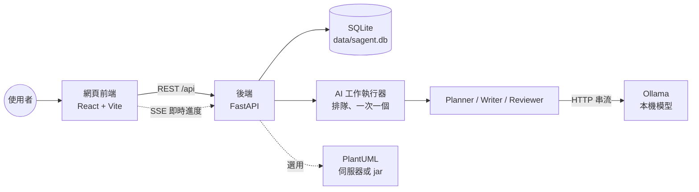
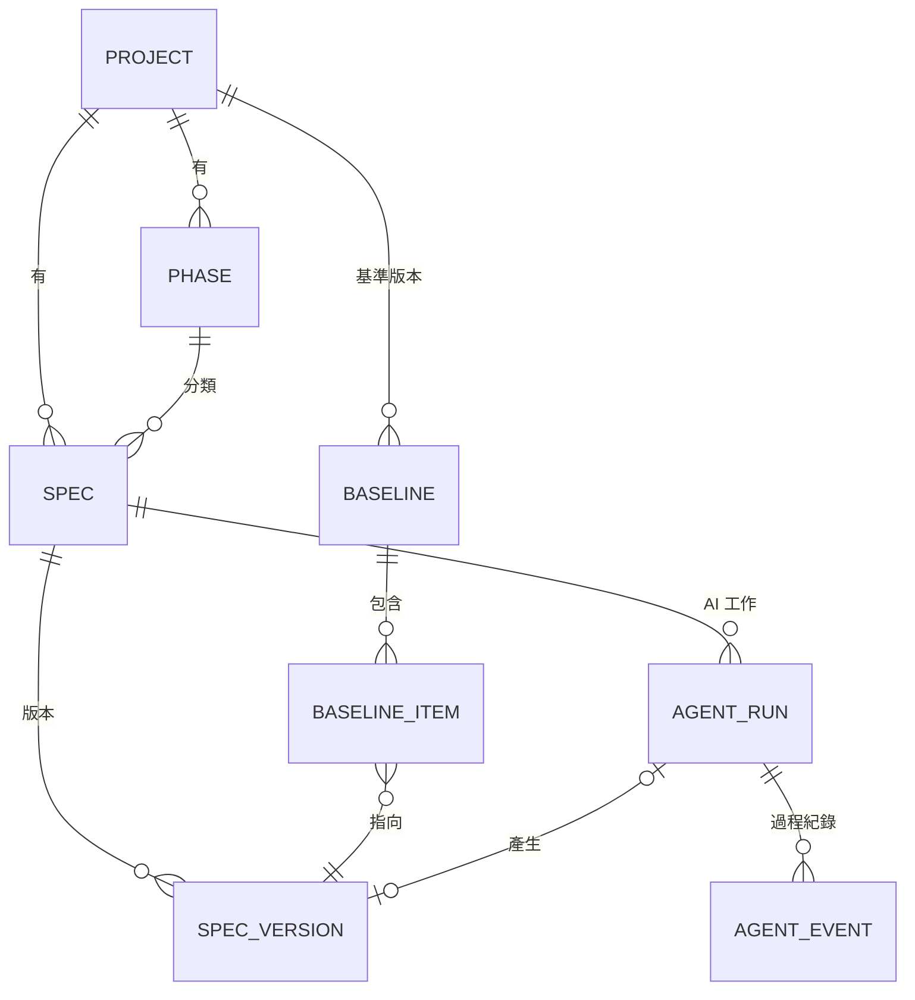
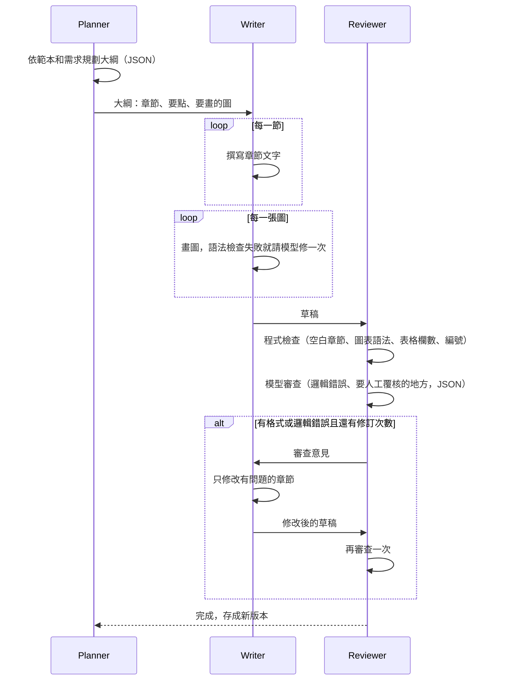

# SAgent 架構說明

這份文件說明 SAgent 怎麼組成、資料怎麼存、AI 代理怎麼運作，以及幾個重要的設計決定。

## 1. 整體架構



| 元件 | 技術 | 職責 |
|---|---|---|
| 網頁前端 | React 19、Vite 8、TanStack Query、CodeMirror、Mermaid 12 | 編輯、預覽、版本、AI 面板 |
| 後端 API | Python、FastAPI、SQLAlchemy | 專案、Spec、版本、基準版本、匯出 |
| AI 工作執行器 | asyncio 背景工作 | 排隊執行 AI 工作、推送進度 |
| AI 代理 | 自己實作（沒有用 LangChain 等框架） | 規劃、撰寫、審查 |
| 模型 | Ollama（例如 qwen3:8b） | 地端推論，資料不出公司 |
| 資料庫 | SQLite（WAL 模式） | 單一檔案，好備份 |

前端打包後是靜態檔，由後端直接提供。執行時不需要 Node.js。

## 2. 資料模型



| 資料表 | 說明 |
|---|---|
| projects | 專案 |
| phases | 功能階段，名稱自訂（例如「需求分析」「第二期」），可排序 |
| specs | Spec 文件，記錄目前最新版本號 `head_version_no`、狀態、是否封存，以及從哪一份 Spec 轉過來的 `source_spec_id`（例如構想 → 功能規格） |
| spec_versions | 每個版本的完整內容，以及跟前一版比較新增、刪除幾行。建立後不再修改，只有「標籤」可以改 |
| baselines / baseline_items | 基準版本：某個時間點每份 Spec 用的是哪一版 |
| agent_runs | AI 工作：需求、選項、大綱、審查結果、用量、結果版本 |
| agent_events | AI 工作的步驟紀錄（開始、結束、警告），可重播 |
| settings | 畫面上可調整的設定 |

資料庫升級：新的資料表啟動時自動建立；舊資料表要加欄位時，寫在 `backend/sagent/migrations.py`，啟動時自動執行，已經升級過就不會重做。

## 3. 版本控制

規則很簡單：

1. 每次存檔都產生新版本（v1、v2、v3…），舊版本永遠保留。
2. 內容沒變就不產生新版本。
3. 存檔時會帶「我是根據第幾版改的」。如果別人（或 AI）已經存了更新的版本，會回 409，畫面提示使用者比較差異後再決定。
4. 還原 = 把舊版內容存成新版本，不會刪掉任何版本。
5. 版本可以加標籤（例如「客戶確認版」）。
6. 基準版本記錄整個專案（或某個階段）當下的版本組合，之後可以：
   - 跟目前最新版比較：哪些 Spec 有變更、新增、移除
   - 兩個基準版本互相比較
   - 匯出當時的所有文件（zip）

差異比較有兩層：

- 逐行比較（Python difflib）
- 章節比較：以 `##` 標題為單位，標出新增、刪除、修改的章節

為什麼不用 git：SQLite 的版本表就能做到上面所有功能，查詢快、交易安全、備份只要複製一個檔案。需要放進 git 時，可以用「匯出 zip」取得 Markdown 檔。

## 4. AI 代理

每次 AI 工作都是三個 agent 合作：



### 4.1 兩種模式

| 模式 | 做什麼 |
|---|---|
| 撰寫 | 依需求從頭寫一份完整文件 |
| 修訂 | Planner 讀既有文件，只列出要修改、刪除、新增的章節；沒提到的章節原樣保留，不送給模型 |

### 4.2 為了小模型做的設計

小模型（8B 左右）在 CPU 上跑，又慢又容易出錯，所以：

| 問題 | 做法 |
|---|---|
| 一次寫整份文件容易失焦、太長 | 一節一節寫，每次只給這一節的目標和要點 |
| JSON 容易寫壞 | 用 Ollama 的 `format`（JSON Schema）約束；壞了重試一次；再壞就改用範本章節（備案） |
| 圖表語法常寫錯 | 每種圖給一個「確定能畫出來」的範例；程式自動修正常見錯誤（例如節點文字有括號沒加引號）；檢查失敗請模型修一次 |
| 跨章節編號不一致 | 把前面章節的編號項目（FR-01…）傳給後面的章節 |
| 修改時把圖改壞 | 依審查意見修改文字時，把圖換成 `[[圖1]]` 標記，改完再放回去 |
| 模型偷懶只回一小段 | 修改後內容少於原本 40% 就不採用 |
| 各章節自己發明編號 | 哪一節要編號由範本章節的 `ids` 決定，每一節的提示寫明「編號：用 FR-01…」或「不新增編號」，不靠模型讀目標；有 `ids` 的章節沒編號時，審查用程式找出來（見 4.10 節） |
| Planner 改掉章節名稱、漏掉章節 | 結構重要的範本設 `fixed_sections: true`，章節名稱、順序、目標由程式照範本套回去，Planner 只寫要點和圖（見 4.10 節） |
| 偶爾混入簡體字 | 只把「簡體專用字」換成繁體（用前後文挑字），原本的繁體字不動。整段用 OpenCC 轉會把「干擾」「通過」這類詞改壞 |
| 小標題層級亂 | 章節內的 `#`、`##` 降成 `###`；最上層是 `####` 時整體往上調 |
| 審查要讀整份草稿，CPU 上要 10 分鐘 | 修訂後的再審查只送修改過的章節，其他章節沿用上一輪的意見 |
| CPU 很慢 | 關閉 thinking；`keep_alive` 讓模型留在記憶體；先寫完所有文字再畫所有圖，讓相同開頭的提示詞可以重用 Ollama 的快取；JSON 要求不縮排 |

### 4.3 圖表

| 圖 | 預設語法 | 說明 |
|---|---|---|
| 流程圖、循序圖、類別圖、狀態圖、實體關聯圖、甘特圖 | Mermaid | 前端直接畫 |
| 使用案例圖 | Mermaid 12 的 `usecase-beta` | 真正的 UML 使用案例圖（角色、系統邊界、include/extend） |
| 元件圖、部署圖 | Mermaid flowchart | 有設定 PlantUML 時改用 PlantUML |

語法檢查規則是用前端同版本的 Mermaid 實際解析 102 個案例校正過的（`backend/tests/data/mermaid_cases.json`），檢查結果跟 Mermaid 一致。

編輯器「插入圖表」選單的內容在 `services/diagram_snippets.py`，由 `GET /api/agent/diagram-kinds` 提供，跟 AI 用的範例（`agents/diagram_kinds.py`）分開：

- AI 的範例要完整，小模型才照得來；插入用的是精簡骨架，文字用佔位字，語法提示寫成註解。
- 選單多了泳道流程圖、心智圖、象限圖、使用者旅程圖、時間軸，但沒有加進 AI 的圖表種類。種類會寫進 Planner 的提示詞，越多小模型越容易選錯。
- 骨架的 key 跟 AI 圖表種類相同，前端用範本各章節的 `diagrams` 列出「這份文件常用」的圖。
- 每個骨架都要通過程式檢查，並且在 `mermaid_cases.json` 有 `snippet_*` 案例（測試會比對內容是否一致）。

### 4.4 進度怎麼送到畫面

1. 每個步驟的開始、結束、警告存進 `agent_events`，並即時推給前端（SSE）。
2. 模型逐字輸出不存資料庫，每 0.15 秒合併推送一次。
3. 前端斷線重連時帶 `Last-Event-ID`，後端從那裡補送。
4. 已結束的工作打開時會重播全部事件，所以可以回頭看每一步的大綱、圖、審查結果。

### 4.5 執行規則

- 一次只跑一個 AI 工作，其他排隊（CPU 同時跑多個只會更慢）。
- 同一份 Spec 同時只能有一個 AI 工作。
- AI 執行期間使用者如果改了文件，AI 結果仍存成最新版本，並提示用版本比較確認。
- 伺服器重啟時：排隊中的工作重新排隊，執行到一半的標成失敗。

### 4.6 建議類文件（UI/UX 設計建議）

一般的規格文件只能寫需求裡有的內容。建議類文件的目的是提出需求沒寫的做法，所以規則不同。範本設 `advice: true` 就會套用：

| 項目 | 規格文件 | 建議類文件 |
|---|---|---|
| 角色 | 系統分析師 | 範本的 `role`（UI/UX 設計建議是「UI/UX 設計師」） |
| 寫作規則 | 只根據需求撰寫，不能編造 | 可以提出建議，每條要具體、要寫理由；用「建議…」的寫法；需求沒有的事實（數字、既有系統）不能編造 |
| 編號 | 照範本章節的 `ids`，例如 FR、BR | 照範本章節的 `ids`，例如 UX |
| 審查 | 需求沒提到的具體內容列人工覆核 | 超出需求的建議不算錯誤；建議裡用到需求沒提到的事實列人工覆核 |

範本設 `allow_diagrams: false` 時，不管畫面上怎麼選，這次 AI 工作都不畫圖（建立工作時和流程開始時都會檢查）。UI/UX 設計建議兩個都有設定。

提示詞寫在 `backend/sagent/agents/prompts.py`：`_SPEC_RULES` 和 `_ADVICE_RULES` 是兩組寫作規則。審查提示詞各種文件共用，見 4.8 節。

範本用 `style` 指定規則：`spec`（預設）、`advice`、`idea`（見 4.7 節）、`decision`、`algorithm`、`experiment`（見 4.9 節）。舊的 `advice: true` 等於 `style: advice`。

### 4.7 類型與構想文件

新增 Spec 時先選「類型」，再選文件類型。類型是範本的 `category` 欄位，定義在 `doc_templates.py` 的 `CATEGORIES`：

| 類型 | key | 內建文件類型 |
|---|---|---|
| Concept | `idea` | 構想提案 |
| Functionality | `feature` | 功能規格書、使用案例規格、SDD 五節、UI/UX 設計建議、測試計畫 |
| Technical | `design` | 技術決策、系統架構設計、資料庫設計、API 規格、實驗設計 |
| Algorithm | `algorithm` | 演算法設計 |
| Change | `change` | 變更需求說明、變更紀錄 |

類型由文件類型決定，`specs` 不另外存類型，舊資料不用升級。自訂範本沒寫 `category` 時歸到 Functionality。

各類型的分工：

- Concept：天馬行空，整理想法、使用者故事和怎樣算成功。轉成功能規格時，使用者故事接到使用案例，驗收條件接到驗證方式。
- Functionality：解決具體問題，寫使用案例、規則和驗證方式，搭配 UML 圖。
- Technical：先用「技術決策」比較幾個方案、選出一個，再寫架構、資料庫、API。需要數據才能決定時，用「實驗設計」去驗證，所以實驗設計放在這個類型。
- Algorithm：演算法的規格和設計策略，搭配流程圖。
- Change：「變更需求說明」是改之前用的（要改什麼、怎麼上線）；「變更紀錄」是改完之後用的（差異和原因），不畫圖。

構想文件（`style: idea`）的想法還不成熟，需求常常只有兩三句。小模型為了填滿章節容易編造，所以規則不同：

| 項目 | 構想文件 |
|---|---|
| 寫作規則 | 不寫細節規格（欄位、API、FR 編號需求）；資訊不夠就寫短、標「待確認」；只有目標寫明「可以提出需求沒寫的做法」的章節（「可能的做法」）才能提建議 |
| 使用者故事、驗收條件 | 使用者故事寫成「身為…我想要…以便…」，編號 US-01；驗收條件編號 AC-01，對應 US 編號，只寫使用者看得到的結果，不寫欄位、錯誤碼、畫面細節 |
| Planner | 章節少、內容短，不清楚的地方多寫進 open_questions |
| 圖 | 範本設 `max_diagrams: 1`，最多一張 |
| 審查 | 內容本來就不完整，不要求補細節；寫成細節規格（欄位、API、FR 編號需求）算格式錯誤；使用者故事和粗略的驗收條件不算 |

寫作規則是 `_IDEA_RULES`。

構想確定要做時，前端的「轉成功能規格」會開新增 Spec 對話框，帶入構想文件目前的內容當需求，建立時傳 `source_spec_id`。來源 Spec 要在同一個專案。Spec 詳細資料會回傳 `source_spec`（來源）和 `derived_specs`（從這份轉出去的 Spec）。

### 4.8 審查（Reviewer）

Reviewer 只做兩件事，不評論寫得好不好、完不完整，也不打分數（舊的 AI 工作紀錄還留著當時的分數）：

| 找什麼 | 誰找 | 結果怎麼處理 |
|---|---|---|
| 格式錯誤：空白章節、圖表語法、表格欄數不一致、引用了沒定義的編號 | 程式（`reviewer.py` 的 `static_checks()`） | 寫進 `issues`，交給 Writer 修正 |
| 邏輯錯誤：前後矛盾、跟需求矛盾、條件衝突、流程或狀態有缺口 | 模型 | 寫進 `issues`，交給 Writer 修正 |
| 文件標註（假設）、（待確認）的地方 | 程式（`marked_points()`） | 寫進 `review_points`，只列給使用者 |
| 需求沒提到、文件卻寫得很具體的內容；要業務單位決定的事 | 模型 | 寫進 `review_points`，只列給使用者 |

- 格式問題盡量用程式檢查，因為小模型數表格欄位、對編號都不可靠。
- 編號檢查只看文件裡有定義過的種類：有定義 FR-01，才會檢查引用的 FR-07 有沒有定義。條列、標題開頭或表格第一欄出現的編號算是定義。
- `issues` 裡 high、medium 的錯誤會觸發修訂；`review_points` 不會。
- 各種文件（規格、建議、構想、技術決策、演算法、實驗）共用 `reviewer_system()`，差別只在 `_REVIEW_STYLE_NOTE` 的一行說明。

### 4.9 技術決策、演算法設計和實驗設計文件

類型 Technical 的「技術決策」（`tech_decision.yaml`，`style: decision`，角色「軟體架構師」）用來比較幾個技術方案、選出一個。規格文件只能寫需求有的內容，但比較方案一定要提出需求沒列的做法，所以規則不同：

| 項目 | 技術決策文件 |
|---|---|
| 寫作規則 | 要做的決定、限制、評估標準照需求，沒寫的不能編造；方案可以由 AI 提出，需求列出的方案一定要比較；每個方案寫做法、優點、缺點；比較用定性的寫法（較好、普通、較差）加理由，不能編造效能、成本、時間的數字，要實測的地方標「待確認」並寫怎麼驗證；建議的理由要對得上比較結果 |
| 編號 | 照範本章節的 `ids`：限制與評估標準 C-01 |
| Planner | key_points 寫限制、評估標準、方案名稱、比較重點；需求沒寫的限制和評估標準寫進 open_questions |
| 圖 | 範本設 `max_diagrams: 2`，只有「建議方案」建議畫元件圖。每個方案都畫圖在 CPU 上太慢，小模型也容易畫錯 |
| 審查 | AI 提出的方案不算編造；比較結果和優缺點對不上、建議的理由和比較結果矛盾、沒有根據的數字算錯誤；需求沒提到的限制或評估標準列人工覆核 |

寫作規則是 `_DECISION_RULES`。

類型 Algorithm 的「演算法設計」（`algorithm_design.yaml`，`style: algorithm`，角色「演算法工程師」）用來設計解決特定問題的演算法，例如數獨的解題和出題。規格文件只能寫需求有的內容，但演算法文件的重點是設計解法，所以規則不同：

| 項目 | 演算法設計文件 |
|---|---|
| 寫作規則 | 輸入、輸出、限制條件、效能要求照需求，沒寫的數字不能編造；解法、資料結構、虛擬碼由 AI 設計，先說明設計策略（暴力法、分治法、貪婪法、動態規劃、回溯法、圖形搜尋等）和理由，再寫步驟；虛擬碼放 ` ```text ` 區塊；複雜度用大 O，說明 n 是什麼 |
| 編號 | 照範本章節的 `ids`，例如測試案例 TC-01 |
| Planner | key_points 寫具體的設計內容；需求沒寫的限制和效能數字寫進 open_questions |
| 圖 | 範本設 `max_diagrams: 2`，通常是解題流程圖 |
| 審查 | AI 設計的解法不算編造；文字、虛擬碼、複雜度、測試案例的預期結果互相矛盾算邏輯錯誤；需求沒提到的限制或效能數字列人工覆核 |

寫作規則是 `_ALGORITHM_RULES`。虛擬碼的 ` ```text ` 區塊不是圖，Writer 整理內文時會保留（只有 ` ```mermaid `、` ```plantuml ` 會被當成圖拿掉）。

類型 Technical 還有「實驗設計」（`experiment_design.yaml`，`style: experiment`，角色「實驗設計研究員」），用來設計評估新工具或新做法的實驗，例如試用 AI 程式碼審查工具。技術決策需要數據才能決定時，就用它去驗證。重點是設計實驗方法，所以也跟規格文件的規則不同：

| 項目 | 實驗設計文件 |
|---|---|
| 寫作規則 | 評估對象、目的、人力、時間、環境和判斷標準照需求，沒寫的數字不能編造；假設、指標、分組、步驟和分析方法由 AI 設計，要寫理由；每個假設寫比較對象、指標和成立條件；統計方法配合資料型態；不能寫實驗結果或編造數據 |
| 編號 | 照範本章節的 `ids`：研究假設 H-01、指標 M-01 |
| Planner | key_points 寫具體的設計內容；需求沒寫的人數、期間和判斷標準寫進 open_questions |
| 圖 | 範本設 `max_diagrams: 2`，通常是實驗流程圖 |
| 審查 | AI 設計的實驗方法不算編造；假設用到沒定義的指標、分析方法不適合資料型態、人數或期間前後不一致、寫出實驗結果算錯誤；需求沒提到的人數、期間或判斷標準列人工覆核 |

寫作規則是 `_EXPERIMENT_RULES`。

### 4.10 範本：固定章節和編號

範本（`doc_templates/*.yaml`）有兩種跟結構有關的設定，都是為了讓小模型少做判斷、讓程式能檢查格式：

**固定章節（`fixed_sections: true`）**

構想提案、使用案例規格、SDD 五節、技術決策、變更紀錄的價值在固定結構，小模型規劃時卻常改名或漏掉章節。設了之後：

| 步驟 | 做法 |
|---|---|
| Planner 提示詞 | 規則改成「章節固定，不能刪除、新增或改名」 |
| JSON Schema | `plan_schema()` 把 `heading` 限制成範本章節名稱（`enum`），數量跟範本一樣 |
| 整理大綱 | `planner.py` 的 `_fit_template()`：章節名稱、順序、目標照範本；要點和圖用 Planner 給的（先配對名稱一樣的，再配對互相包含的）。Planner 漏掉的章節照樣寫，多出來的不用。不受 `max_sections` 限制 |
| 修訂 | 提示詞要求不刪章節；Planner 還是要刪範本裡的章節時，程式改成保留 |

目標用範本的而不是 Planner 改寫過的，是因為目標裡有格式要求（表格欄位），以及「可以提出需求沒寫的做法」這類寫作規則要看的字。

**編號（章節的 `ids`）**

以前哪一節要編號寫在目標裡（「編號 FR-01、FR-02…」），要靠模型讀懂，Planner 改寫目標時還可能弄丟。現在：

- 範本章節寫 `ids: FR`，Planner 整理大綱時把對應的範本章節的 `ids` 放進 `SectionPlan.ids`（章節名稱對不上時，看目標裡有沒有「編號 XX-01」）。
- Writer 每一節的提示多一行「編號：這一節的項目用 FR-01、FR-02… 編號」或「編號：這一節不新增編號」。共用的寫作規則只有一條：有指定格式才新增編號。
- Reviewer 的程式檢查 `has_item_ids()`：有 `ids` 的章節沒有定義任何這種編號（條列開頭、標題開頭或表格第一欄），算格式錯誤（medium），交給 Writer 修正。審查提示的章節清單也標出每節定義哪種編號。
- 自訂範本沒寫 `ids` 時，從目標裡的「編號 FR-01」找出來，舊範本不用改。

## 5. API 一覽

| 方法 | 路徑 | 說明 |
|---|---|---|
| GET/POST | `/api/projects` | 專案清單（含各階段的 Spec 數量、執行中和排隊中的 AI 工作數量）、建立專案 |
| GET/PATCH/DELETE | `/api/projects/{id}` | 專案（含階段與 Spec 清單） |
| POST | `/api/projects/{id}/phases` | 新增階段 |
| POST | `/api/projects/{id}/phases/reorder` | 調整階段順序 |
| PATCH/DELETE | `/api/phases/{id}` | 修改、刪除階段 |
| GET/POST | `/api/projects/{id}/specs` | Spec 清單（可搜尋）、建立 Spec |
| GET/PATCH | `/api/specs/{id}` | Spec 內容與屬性 |
| PUT | `/api/specs/{id}/content` | 存檔（產生新版本） |
| POST | `/api/specs/{id}/archive`、`/unarchive` | 封存、取消封存 |
| GET | `/api/specs/{id}/versions`、`/versions/{no}` | 版本清單、版本內容 |
| POST | `/api/specs/{id}/versions/{no}/restore` | 還原 |
| PUT | `/api/specs/{id}/versions/{no}/label` | 版本標籤 |
| GET | `/api/specs/{id}/diff` | 差異比較 |
| GET | `/api/specs/{id}/export` | 下載 Markdown |
| GET/POST | `/api/projects/{id}/baselines` | 基準版本 |
| GET/DELETE | `/api/baselines/{id}` | 基準版本內容 |
| GET | `/api/projects/{id}/compare` | 比較基準版本 |
| GET | `/api/projects/{id}/export` | 匯出 zip（最新版或某個基準版本） |
| GET | `/api/agent/templates`、`/api/agent/template-categories`、`/api/agent/models` | 文件範本、類型、模型清單 |
| POST/GET | `/api/agent/runs` | 建立、查詢 AI 工作 |
| GET | `/api/agent/runs/{id}` | AI 工作詳細內容 |
| GET | `/api/agent/runs/{id}/events` | 即時進度（SSE） |
| POST | `/api/agent/runs/{id}/cancel` | 取消 |
| GET/PUT | `/api/settings` | 設定 |
| GET | `/api/health` | 系統狀態 |
| POST | `/api/render/plantuml` | PlantUML 轉 SVG |

啟動後可以在 `http://127.0.0.1:8765/docs` 看到完整的 API 文件。

## 6. 程式結構

```
backend/sagent/
  main.py            FastAPI 應用程式、提供前端檔案
  config.py          啟動設定（環境變數）
  models.py          資料表
  api/               API 路由
  services/          版本控制、基準版本、匯出、差異、圖表檢查、插入圖表的骨架、PlantUML
  agents/
    llm.py           Ollama 用戶端（串流、JSON Schema）
    planner.py       Planner
    writer.py        Writer
    reviewer.py      Reviewer
    pipeline.py      串起三個 agent
    runner.py        背景執行、事件推送
    prompts.py       提示詞
    diagram_kinds.py 各種圖的語法規則和範例
    fake_llm.py      假模型（測試、示範用）
  doc_templates/     內建文件範本（YAML）
frontend/src/
  pages/             頁面
  components/        編輯器、預覽、版本、差異、AI 面板
  hooks/useRunStream.ts  訂閱 AI 進度
```
