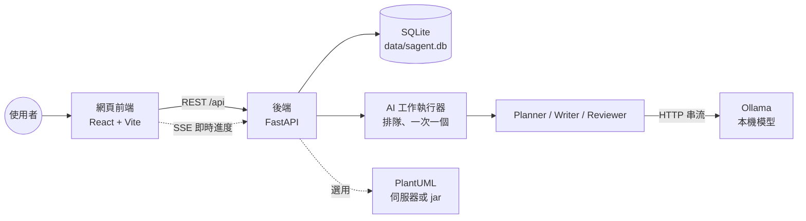
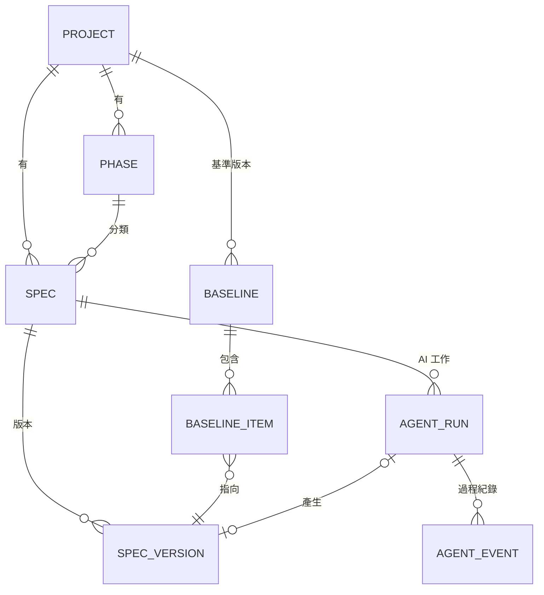
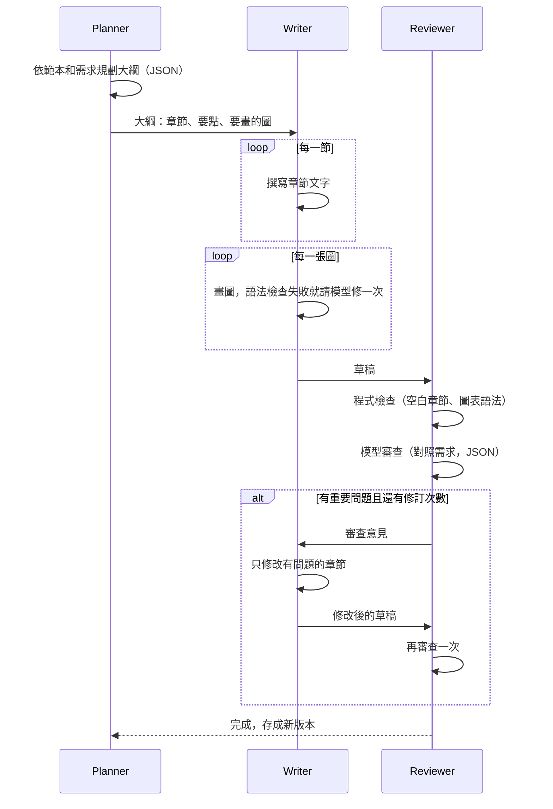

# SAgent 架構說明

這份文件說明 SAgent 怎麼組成、資料怎麼存、AI 代理怎麼運作，以及幾個重要的設計決定。

## 1. 整體架構



| 元件 | 技術 | 職責 |
|---|---|---|
| 網頁前端 | React 19、Vite 8、TanStack Query、CodeMirror、Mermaid 12 | 編輯、預覽、版本、AI 面板 |
| 後端 API | Python、FastAPI、SQLAlchemy | 專案、Spec、版本、基準版本、匯出 |
| AI 工作執行器 | asyncio 背景工作 | 排隊執行 AI 工作、推送進度 |
| AI 代理 | 自己實作（沒有用 LangChain 等框架） | 規劃、撰寫、審查 |
| 模型 | Ollama（例如 qwen3:8b） | 地端推論，資料不出公司 |
| 資料庫 | SQLite（WAL 模式） | 單一檔案，好備份 |

前端打包後是靜態檔，由後端直接提供。執行時不需要 Node.js。

## 2. 資料模型



| 資料表 | 說明 |
|---|---|
| projects | 專案 |
| phases | 功能階段，名稱自訂（例如「需求分析」「第二期」），可排序 |
| specs | Spec 文件，記錄目前最新版本號 `head_version_no`、狀態、是否封存 |
| spec_versions | 每個版本的完整內容，以及跟前一版比較新增、刪除幾行。建立後不再修改，只有「標籤」可以改 |
| baselines / baseline_items | 基準版本：某個時間點每份 Spec 用的是哪一版 |
| agent_runs | AI 工作：需求、選項、大綱、審查結果、用量、結果版本 |
| agent_events | AI 工作的步驟紀錄（開始、結束、警告），可重播 |
| settings | 畫面上可調整的設定 |

資料庫升級：新的資料表啟動時自動建立；舊資料表要加欄位時，寫在 `backend/sagent/migrations.py`，啟動時自動執行，已經升級過就不會重做。

## 3. 版本控制

規則很簡單：

1. 每次存檔都產生新版本（v1、v2、v3…），舊版本永遠保留。
2. 內容沒變就不產生新版本。
3. 存檔時會帶「我是根據第幾版改的」。如果別人（或 AI）已經存了更新的版本，會回 409，畫面提示使用者比較差異後再決定。
4. 還原 = 把舊版內容存成新版本，不會刪掉任何版本。
5. 版本可以加標籤（例如「客戶確認版」）。
6. 基準版本記錄整個專案（或某個階段）當下的版本組合，之後可以：
   - 跟目前最新版比較：哪些 Spec 有變更、新增、移除
   - 兩個基準版本互相比較
   - 匯出當時的所有文件（zip）

差異比較有兩層：

- 逐行比較（Python difflib）
- 章節比較：以 `##` 標題為單位，標出新增、刪除、修改的章節

為什麼不用 git：SQLite 的版本表就能做到上面所有功能，查詢快、交易安全、備份只要複製一個檔案。需要放進 git 時，可以用「匯出 zip」取得 Markdown 檔。

## 4. AI 代理

每次 AI 工作都是三個 agent 合作：



### 4.1 兩種模式

| 模式 | 做什麼 |
|---|---|
| 撰寫 | 依需求從頭寫一份完整文件 |
| 修訂 | Planner 讀既有文件，只列出要修改、刪除、新增的章節；沒提到的章節原樣保留，不送給模型 |

### 4.2 為了小模型做的設計

小模型（8B 左右）在 CPU 上跑，又慢又容易出錯，所以：

| 問題 | 做法 |
|---|---|
| 一次寫整份文件容易失焦、太長 | 一節一節寫，每次只給這一節的目標和要點 |
| JSON 容易寫壞 | 用 Ollama 的 `format`（JSON Schema）約束；壞了重試一次；再壞就改用範本章節（備案） |
| 圖表語法常寫錯 | 每種圖給一個「確定能畫出來」的範例；程式自動修正常見錯誤（例如節點文字有括號沒加引號）；檢查失敗請模型修一次 |
| 跨章節編號不一致 | 把前面章節的編號項目（FR-01…）傳給後面的章節 |
| 修改時把圖改壞 | 依審查意見修改文字時，把圖換成 `[[圖1]]` 標記，改完再放回去 |
| 模型偷懶只回一小段 | 修改後內容少於原本 40% 就不採用 |
| 各章節自己發明編號 | 規定只有負責列需求的章節（目標寫明要編號）才能新增 FR/BR/NFR/AC 編號，其他章節只能引用 |
| 偶爾混入簡體字 | 只把「簡體專用字」換成繁體（用前後文挑字），原本的繁體字不動。整段用 OpenCC 轉會把「干擾」「通過」這類詞改壞 |
| 小標題層級亂 | 章節內的 `#`、`##` 降成 `###`；最上層是 `####` 時整體往上調 |
| 審查要讀整份草稿，CPU 上要 10 分鐘 | 修訂後的再審查只送修改過的章節，其他章節沿用上一輪的意見 |
| CPU 很慢 | 關閉 thinking；`keep_alive` 讓模型留在記憶體；先寫完所有文字再畫所有圖，讓相同開頭的提示詞可以重用 Ollama 的快取；JSON 要求不縮排 |

### 4.3 圖表

| 圖 | 預設語法 | 說明 |
|---|---|---|
| 流程圖、循序圖、類別圖、狀態圖、實體關聯圖、甘特圖 | Mermaid | 前端直接畫 |
| 使用案例圖 | Mermaid 12 的 `usecase-beta` | 真正的 UML 使用案例圖（角色、系統邊界、include/extend） |
| 元件圖、部署圖 | Mermaid flowchart | 有設定 PlantUML 時改用 PlantUML |

語法檢查規則是用前端同版本的 Mermaid 實際解析 88 個案例校正過的（`backend/tests/data/mermaid_cases.json`），檢查結果跟 Mermaid 一致。

### 4.4 進度怎麼送到畫面

1. 每個步驟的開始、結束、警告存進 `agent_events`，並即時推給前端（SSE）。
2. 模型逐字輸出不存資料庫，每 0.15 秒合併推送一次。
3. 前端斷線重連時帶 `Last-Event-ID`，後端從那裡補送。
4. 已結束的工作打開時會重播全部事件，所以可以回頭看每一步的大綱、圖、審查結果。

### 4.5 執行規則

- 一次只跑一個 AI 工作，其他排隊（CPU 同時跑多個只會更慢）。
- 同一份 Spec 同時只能有一個 AI 工作。
- AI 執行期間使用者如果改了文件，AI 結果仍存成最新版本，並提示用版本比較確認。
- 伺服器重啟時：排隊中的工作重新排隊，執行到一半的標成失敗。

### 4.6 建議類文件（UI/UX 設計建議）

一般的規格文件只能寫需求裡有的內容。建議類文件的目的是提出需求沒寫的做法，所以規則不同。範本設 `advice: true` 就會套用：

| 項目 | 規格文件 | 建議類文件 |
|---|---|---|
| 角色 | 系統分析師 | 範本的 `role`（UI/UX 設計建議是「UI/UX 設計師」） |
| 寫作規則 | 只根據需求撰寫，不能編造 | 可以提出建議，每條要具體、要寫理由；用「建議…」的寫法；需求沒有的事實（數字、既有系統）不能編造 |
| 編號 | FR、BR、NFR、AC | 照章節目標寫的格式，例如 UX-01 |
| 審查重點 | 漏寫、矛盾、編造 | 漏掉需求重點、跟需求矛盾、編造事實、建議空泛或沒有理由。超出需求的建議不算問題 |

範本設 `allow_diagrams: false` 時，不管畫面上怎麼選，這次 AI 工作都不畫圖（建立工作時和流程開始時都會檢查）。UI/UX 設計建議兩個都有設定。

規格文件的提示詞沒有改變。提示詞寫在 `backend/sagent/agents/prompts.py`：`_SPEC_RULES` 和 `_ADVICE_RULES` 是兩組寫作規則，`advice_reviewer_system()` 是建議類文件的審查提示詞。

## 5. API 一覽

| 方法 | 路徑 | 說明 |
|---|---|---|
| GET/POST | `/api/projects` | 專案清單（含各階段的 Spec 數量）、建立專案 |
| GET/PATCH/DELETE | `/api/projects/{id}` | 專案（含階段與 Spec 清單） |
| POST | `/api/projects/{id}/phases` | 新增階段 |
| POST | `/api/projects/{id}/phases/reorder` | 調整階段順序 |
| PATCH/DELETE | `/api/phases/{id}` | 修改、刪除階段 |
| GET/POST | `/api/projects/{id}/specs` | Spec 清單（可搜尋）、建立 Spec |
| GET/PATCH | `/api/specs/{id}` | Spec 內容與屬性 |
| PUT | `/api/specs/{id}/content` | 存檔（產生新版本） |
| POST | `/api/specs/{id}/archive`、`/unarchive` | 封存、取消封存 |
| GET | `/api/specs/{id}/versions`、`/versions/{no}` | 版本清單、版本內容 |
| POST | `/api/specs/{id}/versions/{no}/restore` | 還原 |
| PUT | `/api/specs/{id}/versions/{no}/label` | 版本標籤 |
| GET | `/api/specs/{id}/diff` | 差異比較 |
| GET | `/api/specs/{id}/export` | 下載 Markdown |
| GET/POST | `/api/projects/{id}/baselines` | 基準版本 |
| GET/DELETE | `/api/baselines/{id}` | 基準版本內容 |
| GET | `/api/projects/{id}/compare` | 比較基準版本 |
| GET | `/api/projects/{id}/export` | 匯出 zip（最新版或某個基準版本） |
| GET | `/api/agent/templates`、`/api/agent/models` | 文件範本、模型清單 |
| POST/GET | `/api/agent/runs` | 建立、查詢 AI 工作 |
| GET | `/api/agent/runs/{id}` | AI 工作詳細內容 |
| GET | `/api/agent/runs/{id}/events` | 即時進度（SSE） |
| POST | `/api/agent/runs/{id}/cancel` | 取消 |
| GET/PUT | `/api/settings` | 設定 |
| GET | `/api/health` | 系統狀態 |
| POST | `/api/render/plantuml` | PlantUML 轉 SVG |

啟動後可以在 `http://127.0.0.1:8765/docs` 看到完整的 API 文件。

## 6. 程式結構

```
backend/sagent/
  main.py            FastAPI 應用程式、提供前端檔案
  config.py          啟動設定（環境變數）
  models.py          資料表
  api/               API 路由
  services/          版本控制、基準版本、匯出、差異、圖表檢查、PlantUML
  agents/
    llm.py           Ollama 用戶端（串流、JSON Schema）
    planner.py       Planner
    writer.py        Writer
    reviewer.py      Reviewer
    pipeline.py      串起三個 agent
    runner.py        背景執行、事件推送
    prompts.py       提示詞
    diagram_kinds.py 各種圖的語法規則和範例
    fake_llm.py      假模型（測試、示範用）
  doc_templates/     內建文件範本（YAML）
frontend/src/
  pages/             頁面
  components/        編輯器、預覽、版本、差異、AI 面板
  hooks/useRunStream.ts  訂閱 AI 進度
```
